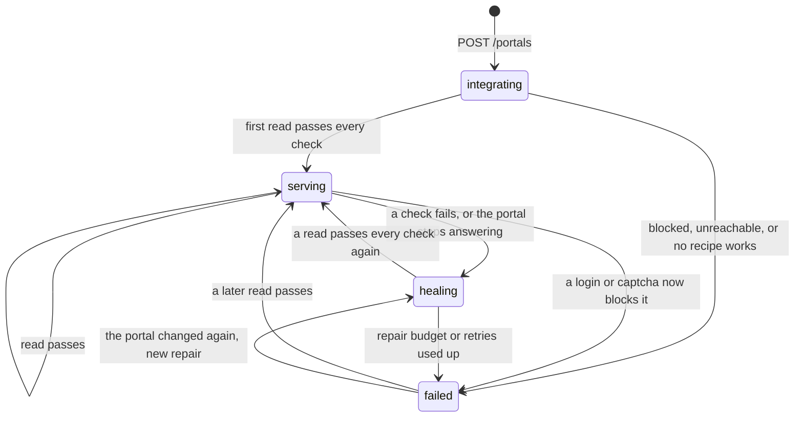
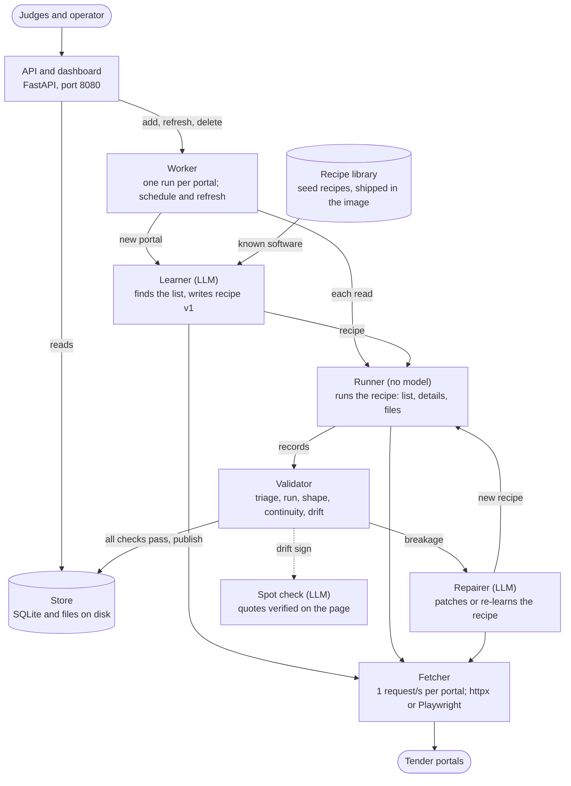

# Watchtower: Design Doc

Patterno track · draft 2 of 2026-11-20 · reviewed against the track description

## Changes in draft 2

Draft 1 was reviewed against the track description and the participant declaration. The approach stands: learn a recipe once, read without a model, check every read, repair on failure. The changes are below; each names the section it landed in.

**Corrected against the brief**

- A list is a bare JSON array, a document's link field is named `path`, and `changedSince` means strictly later. (API contract)
- The model key values go to the judges at hand-in, so the key needs a spending cap. (Rules, Hand-in checklist)
- The image must build quickly on small to medium machines, not only on ours. (Hand-in)
- Each member signs the participant declaration; it rules out an open-source licence on the repo. (Hand-in)

**Contradiction resolved**

- Draft 1 published tenders as they were read, and also held them until every check passed. Nothing is published before a read passes; attach progress goes in `reason`. (Read budget and schedule)

**Gaps filled**

- Triage before repair: an outage, a login wall and a changed layout need three different answers. (Notice)
- Drift signals that catch wrong data on reads that still pass every other check. (Notice)
- Repair accepted only if it reproduces the last good records; a repair ladder and a budget that refresh calls cannot drain. (Repair)
- Incremental reads, because at 1 request per second a full re-read of a large portal takes 20 minutes. (Read budget and schedule)
- The browser's sub-requests go through the same rate limiter as everything else. (Stack)
- A seed recipe library ships in the image; a fresh container has learned nothing. (Reuse across portals)
- How the learner gets from a bare URL to a recipe. (Attach)
- What the dashboard shows. (Dashboard)
- Restart recovery, portals running side by side, an API that never stalls. (Rules the worker enforces)
- Mock portal, contract test and the linux/amd64 build moved to the first three hours. (Build plan)

**Answered here, open in draft 1**

- Read interval: 5 minutes, or 3 times the last read's duration if that is longer.
- A `failed` portal is read again on refresh and once an hour. A new repair starts only when the portal has changed since we gave up.
- Option A stays the main path, with a decision point at hour 10.

## Context: the Patterno challenge

In 24 hours, as a team of 3 to 4, we build "the Watchtower": an agent that attaches to a public-tender portal it has never seen, notices when that portal stops delivering correctly, and repairs itself. Nobody may help it while it runs.

Patterno collects tenders from more than 4,500 procurement portals in 29 European countries. Today each new portal is connected by hand, and when a portal changes, its tenders can stop arriving without anyone noticing. The winning system goes into production.

Source: [hackathon-pdfs/Patterno-Track-Description.pdf](hackathon-pdfs/Patterno-Track-Description.pdf)

### What is judged

The judges run our container on portals it has never seen: private ones they built for the challenge, and real ones.

| Criterion | What they check |
| --- | --- |
| Attach | Tenders and documents delivered correctly from an unseen portal |
| Notice | The state we report matches what we actually deliver |
| Repair | Correct delivery again after a portal has changed |
| Dashboard | An operator sees which portals deliver, which broke, and what the system did about it |
| Approach | How well it would scale to many more portals, and the model cost per portal |

### Rules that shape the design

- Any language, framework and model. Model keys come from environment variables, are named in the README, and their values are given to the judges at hand-in.
- The LLM learns how a portal is read, checks it and repairs it. Regular reads should ideally make no model call.
- No steering: no person and no service of ours may direct the system during the run. Everything it needs ships in the image.
- Politeness: at most 1 request per second per portal, no logins, no captcha solving.

### Hand-in

- A Git repo with a Dockerfile at its root, linked in the hackathon submission. `docker build .` must work on linux/amd64 and build relatively quickly on small to medium machines; the default command serves the API and dashboard on port 8080.
- A one-page README: how it works, the environment variables, and the model cost of one portal.
- A video of at most 3 minutes showing the system at work, dashboard included.
- The values of the model keys, for the judges to run the container with.
- A signed participant declaration from each member. It is a condition for the prize and the final, and gives Patterno an exclusive licence on what we build, so the repo carries no open-source licence. Source: [hackathon-pdfs/Patterno_Participant_Declaration_MAIN_2026.pdf](hackathon-pdfs/Patterno_Participant_Declaration_MAIN_2026.pdf)

### API contract

Every answer is JSON (except the dashboard and file bytes), with no authentication. A list is a bare JSON array, not an object wrapping one. Unknown ids answer 404. Times carry an offset, for example `2026-12-09T10:00:00+01:00`.

| Call | Answer |
| --- | --- |
| `POST /portals` `{"url"}` | 201 `{"id"}` at once, attach in the background. The same URL twice returns the same id. |
| `GET /portals`, `GET /portals/{id}` | 200: `id`, `url`, `state`, `reason` in words, `tenderCount`, `lastSuccessAt` or null |
| `DELETE /portals/{id}` | 204. We stop calling the portal within a minute. |
| `POST /portals/{id}/refresh` | 202 `{"runId"}` at once. If a read is already running, return its `runId`. May be called every few minutes. |
| `GET /portals/{id}/tenders` | 200 list of tenders. `?changedSince=` keeps only tenders whose `lastChangedAt` is later. |
| `GET /portals/{id}/runs` | 200 list: `id`, `kind` (read or repair), `startedAt`, `finishedAt` or null, `result` (ok, failed, null while running). The first attach is a read. |
| `GET /files/{id}` | The bytes of one document. The route is ours; each document's `path` points to it. |
| `GET /` | The dashboard |

A portal is in one of four states:

| State | Meaning |
| --- | --- |
| `integrating` | Being attached, nothing delivered yet |
| `serving` | Delivering correctly |
| `healing` | Broken, repair running; the last correct tenders are still served |
| `failed` | Cannot deliver, a person is needed. A login or captcha block lands here, with the reason. |

### Where the brief is silent

The brief leaves these open. We decide them once, here, so we all build the same thing.

- **Portal id.** Derived from the normalised URL (scheme and host in lower case, no fragment, no trailing slash), so the same address always gives the same id, also after a restart. A repeated `POST` answers 201 with that id.
- **After a delete.** The id is unknown again and every route under it answers 404. Its tenders and files are removed. Adding the address again starts a fresh attach under the same id.
- **`reason`.** Always a sentence, also when all is well: "Read at 14:02 found 23 tenders; every check passed."
- **`tenderCount`.** The length of the tenders list, closed and withdrawn tenders included.
- **Tenders while `integrating`.** 200 with `[]`.
- **`changedSince`.** A `+` in the offset arrives as a space when the caller does not percent-encode it; we accept both. A value we cannot parse answers 400.
- **Refresh during a repair.** Answers with the repair's `runId`. A repair run ends with a full verifying read and publishes on success, so when that run finishes the tenders are fresh.
- **Refresh on a `failed` portal.** Starts a read. See Repair for when that leads to a new repair.
- **Extra fields.** We add our own fields to runs and portals (cost, failed checks, a summary in words). We never rename or drop one from the contract.

### Tender record

| Field | Required | Notes |
| --- | --- | --- |
| `id` | yes | The portal's own identifier, stable across reads |
| `url` | yes | The tender's page |
| `title` | yes | As the portal states it |
| `buyerName` | yes | The public body buying |
| `publicationDate` | yes | A date, `2026-11-20` |
| `submissionDeadline` | yes | Date and time with offset |
| `status` | yes | `open`, `closed` (deadline passed or no longer listed), `withdrawn` (cancelled) |
| `documents` | yes | A list. Each file has `fileName`, `sizeBytes`, `sha256` and `path`, our API path to the bytes (`/files/ab12`). ZIPs unpacked; a file over 250 MB, a ZIP included, may be left out. |
| `lastChangedAt` | yes | When we last saw the tender change |
| `referenceNumber` | if shown | The buyer's file number |
| `description` | if shown | What is bought |
| `procedureType` | if shown | `open`, `restricted`, `negotiated`, `other` |
| `contractNature` | if shown | `works`, `services`, `supplies` |
| `cpvCodes` | if shown | A list of 8-digit strings, check digit dropped: `45000000` |
| `placeOfPerformance` | if shown | `postalCode`, `city`, `countryCode` (two letters) |

A required field the portal does not show is sent as null; optional ones are left out. A wrong value scores worse than a missing one.

## Problem and users

The problem is not reading one portal; it is that every portal is different, changes without warning, and fails silently. A scraper written by hand for each of 4,500 portals does not scale, and a broken scraper looks the same as a quiet week.

| Who | What they need from us |
| --- | --- |
| Patterno operator | One page each morning: which portals deliver, which broke, what the system already tried, and which need a person |
| Downstream pipeline (the judges' harness during the challenge) | A stable API with exact fields, stable tender ids and honest portal states |
| Patterno, as the business | A per-portal cost in model usage low enough to run across thousands of portals |

Honesty matters as much as coverage. A portal reported as `serving` that delivers wrong or stale tenders is the failure Patterno has today; a portal reported as `failed` with a clear reason is a useful answer.

## Goals and non-goals

We optimise for correct, honestly reported delivery on unseen portals, at a model cost paid once per portal rather than on every read.

**Goals**

1. Attach: from a bare URL, deliver every open tender with its documents, with no human input.
2. Notice: the reported state always matches what we deliver. When in doubt, report `healing` or `failed` rather than `serving`.
3. Repair: after a portal changes, return to correct delivery on our own, and keep serving the last correct tenders meanwhile.
4. Dashboard: one page an operator can read in a minute, showing state, reason and the run history per portal.
5. Cost: the LLM runs only to learn, check and repair a portal. Regular reads make no model call, and we report the cost per portal in tokens and euros.
6. Scale: portals running the same software share what was learned, so cost grows with the number of software packages, not portals.

**Non-goals**

- Logging in or solving captchas. A blocked portal is reported `failed` with the reason.
- Scoring tenders against company profiles, reading documents for content, or helping with bids. That is Patterno's existing product.
- Filling every optional field. We leave out what we are not sure of.
- Multi-user auth, horizontal scaling or a production database. One container, one process, local storage.

## Proposed solution

Learn once, read cheaply, check every read, re-learn on failure. The LLM turns a portal into a **recipe**, a declarative description of how to read it. A deterministic engine runs the recipe on every read with no model call, a validator checks each result, and when the checks fail the LLM repairs the recipe.

### Portal lifecycle

A portal is reported `serving` only while its reads pass every check. A repair that cannot succeed ends in `failed` with its reason, never in a false `serving`. `failed` is not final: reads continue slowly, and a portal that comes back is served again.

### The recipe

One versioned JSON document per portal, checked against a schema and stored with every run that used it:

- **Source**: how the tender list is fetched. A server-rendered page, a JSON API found in the browser's network traffic, or a page that needs a headless browser. A fetch is a short series of GET or POST steps; cookies are kept for the session and hidden form fields are carried from one step to the next, because some portals page through form posts.
- **Paging**: next-page link, page parameter, API offset or form post.
- **Identity**: where a tender's `id` comes from. It must be an identifier the portal issues (in the URL or on the page), never a row position or a hash of ours, and it must survive a change of layout or URL scheme.
- **List and detail fields**: CSS or XPath selectors for HTML, JSON paths for APIs, each with a normaliser (date format and timezone, CPV check digit, status words in the local language).
- **Documents**: how to reach the files. Direct links, a documents tab, or a multi-step download.
- **Expectations**: what a healthy read looks like, used by the validator. Typical tender count, fill rate of each field, the id pattern, and a fingerprint of the page structure. Updated after every passing read, so slow natural change does not raise alarms.

### Options considered

| Option | How a regular read works | Model calls per read | Verdict |
| --- | --- | --- | --- |
| A. Declarative recipe | Our engine runs selectors and JSON paths from the recipe | 0 | **Recommended**: cheap, inspectable, easy to diff and repair |
| B. Generated code per portal | The LLM writes a Python extractor; we run it in a sandbox | 0 | Fallback only. It needs a sandbox we have no time to build well, and its repairs are harder to verify. |
| C. Agent reads every time | A browser agent drives the portal on each read | Many | Rejected: breaks the "reads without a model" rule, and cost grows with every read |

Decision point at hour 10: if the recipe format cannot express at least half of the test set by then, we add B for those portals and nothing else.

### Attach: how the learner works

The learner is a fixed sequence of small steps, not a free-roaming agent. Each proposal is run at once by the engine and the result goes back to the model, so mistakes surface while they are cheap.

1. **Find the list.** The address may be the portal's home page, a list, or a deep link to one tender, often to a summary page rather than the tender itself. The learner follows the navigation to the list of current tenders. In the browser it records network calls; a JSON API behind the page beats scraping its HTML.
2. **Fingerprint the software** and try the recipes we already hold for it. See Reuse across portals.
3. **Propose, run, check, revise.** The model proposes one part of the recipe at a time: list, paging, identity, detail fields, documents. The engine runs it on live pages; output and errors go back. At most three rounds per part, and a token budget per portal.
4. **Look for a block.** A login form or a captcha in front of the list or the documents ends the attach as `failed` with that reason. A captcha that is shown while the files download anyway is not a block.
5. **Spot check, then the first full read.** Only a read that passes every check makes the portal `serving`.

Pages are trimmed before they reach the model: scripts, styles and SVG removed, repeated rows cut down to two or three examples.

### Notice: how we decide a read is correct

**Triage first.** Not every failed read is a broken recipe, and only one kind is worth model tokens.

| What the read hit | Kind | What we do | State |
| --- | --- | --- | --- |
| Timeouts, 5xx, connection errors | Outage | Retry with growing pauses, no model call | `healing` while retrying; `failed` with "unreachable since …" after 30 minutes |
| Login form, captcha, 401 or 403 on the list or the documents | Block | Nothing. We do not log in and do not solve captchas. | `failed` at once, with the reason |
| Pages answer, but the checks below fail | Breakage | Repair | `healing` |

**Checks on every read, without a model.** A read replaces the last good tenders only if it passes all four.

1. **Run**: the recipe ran to the end and paging reached the last page. A few dead file links on the portal's side are logged on the run; the read fails when more than 10% of pages or files fail.
2. **Shape**: every record validates against the output schema (enum values, 8-digit CPV codes, two-letter country codes, absolute URLs, no id twice). Required fields are present at the rate the expectations say, the deadline falls after publication, ids match the expected pattern. A value that fails validation is sent as null or left out, never guessed, and counts against the fill rate.
3. **Continuity**: compared with the last good read. Tenders do disappear, so the check is on the share: the read fails when more than 30% of the tenders with a future deadline are gone, or the count halves. The portal's own word overrules that: when it prints a count ("23 results", an API total, a "no tenders" notice) and we read exactly that many, the drop is real and the read passes.
4. **Drift**: two signs that the selectors still match but may now read the wrong thing. The page's structure fingerprint differs from the stored one (the skeleton of tags and classes, or the key set of a JSON API). Or the same field changed on more than half of the already known tenders in one read; portals rarely edit all their tenders at once. Either sign triggers a spot check, not a repair; the read passes only if the spot check does.

The percentages are starting values in one config file, to be tuned on the test set.

**Spot check, with the model.** At attach, after a repair, and when a drift sign fires. The model gets a few extracted records and the text of their pages, and must quote the passage that supports each value. We confirm by string match that every quote is on the page, so the model cannot wave a record through. A required field it cannot support fails the check; an optional one is dropped from the recipe.

A failed check keeps the last good tenders published. Between two reads we cannot know that a portal has changed, so the read interval is the longest a broken portal can be reported `serving`. See Read budget and schedule.

### Repair

Cheapest step first; each is tried only if the one before did not pass.

1. **Read again.** Rules out a hiccup.
2. **Try sibling recipes.** If the same software changed on other portals, a recipe that already works there may work here.
3. **Patch.** The model gets the current recipe, the failing checks, the last good records and a fresh snapshot of the portal (HTML and captured network calls), and fixes the part that fails.
4. **Learn again from scratch**, with the learner.

**Acceptance.** A new recipe is swapped in only if a full read with it passes every check and reproduces the last good records: for the tenders both reads contain, the same `id` on at least 90%, and the same title, buyer and dates on at least 90%. The last good records are a regression suite that costs nothing. If the records match but the ids do not, the recipe took the id from the wrong place; it is rejected and retried with that hint. A spot check follows.

**Budget.** At most three model-backed attempts and a token cap per incident. Then the portal is `failed`, with what was tried. After that it is read again on refresh and once an hour, at no model cost. A new repair starts only when the page fingerprint differs from the one we gave up on. Without this rule, a judge calling refresh every few minutes would buy a repair each time.

**What the run records.** The parts of the recipe that changed, taken from the diff, and one sentence in words: "The deadline moved from the fourth column to a labelled field." The dashboard shows both.

### Read budget and schedule

At 1 request per second, requests are the budget. A portal with 200 tenders and 5 files each takes about 1,200 requests to read in full: 20 minutes.

- **The first read is full, and nothing is published before it passes.** That matches `integrating`: nothing delivered yet. While it runs, `reason` shows progress: "Reading tender 120 of 430."
- **A portal that reads in full within two minutes is read in full every time.** That covers small portals, the judges' private ones very likely among them.
- **Larger portals are read incrementally.** List pages every time. Detail pages for new tenders and for those whose list row changed, plus a rotating slice of the rest, so every open tender is looked at again within the hour. A file is downloaded again only when its link, name or announced size changed.
- **Every read re-fetches one known detail page and one known file.** A broken detail or download path is then noticed even when the portal has nothing new.
- **Schedule.** The next read starts 5 minutes after the last one finished, or after 3 times its duration if that is longer. A refresh counts as a read. `READ_INTERVAL_SECONDS` overrides the 5 minutes.

### Reuse across portals

Many portals run the same software under different addresses. At attach we fingerprint the software (URL path, footer, page generator) and try recipes learned on other portals of that software first. A hit still has to pass a full read and a spot check; it skips the learning, which is where the per-portal cost falls toward zero.

The judges start a fresh container, and no service of ours may feed it. So the library ships in the image: recipes exported from our test set, committed to the repo as JSON, keyed by software fingerprint. Recipes learned at run time are added to the same library.

### Cost per portal

The README reports one line per case, measured on the test set by hour 16.

| Case | Model calls | Measured |
| --- | --- | --- |
| Attach, new software | Learner rounds and one spot check | to be measured |
| Attach, known software | One spot check | to be measured |
| Regular read | None | 0 |
| Read with a drift sign | One spot check | to be measured |
| Repair | One to three attempts and one spot check | to be measured |

## Architecture

One Python process in one container: an async web server for the API and dashboard, and a worker loop in the same process that runs reads and repairs. SQLite and a local file store hold everything; the only external calls are to portals and the LLM.

Only the learner, the repairer and the spot check call the model. A regular read of an unchanged portal goes runner → validator without one.

### Stack

| Layer | Choice | Why |
| --- | --- | --- |
| Language | Python 3.12 | Already pinned for this repo |
| API and dashboard | FastAPI, server-rendered HTML that refreshes itself | One process on port 8080, no frontend build step |
| Contract and recipe schemas | pydantic models | One definition validates API answers, tender records and recipes |
| HTTP | httpx (async), one rate limiter per portal | Holds the 1 request per second rule in one place |
| Headless browser | Playwright with Chromium | JavaScript portals, and capturing network calls to find their JSON API. Every browser request passes through the same limiter by route interception; images, fonts, styles and media are blocked. Used to learn, and at read time only when a recipe needs it. |
| HTML parsing | lxml or selectolax | CSS and XPath selectors in recipes |
| Storage | SQLite, files on local disk under `DATA_DIR` | No services to run beside the container |
| Time zones | `zoneinfo` with the `tzdata` package | Deadlines get the zone of the portal's country, so summer and winter time come out right whatever the base image holds |
| LLM | OpenAI model behind one small interface; key from `OPENAI_API_KEY`, model from `WATCHTOWER_MODEL` | Provider assumed from the repo name; see open questions. Recipes come back as structured output and are validated against the schema. |
| Container | Playwright's Python base image | Chromium and its system libraries come prebuilt, so `docker build` stays fast |

### Data

- **portals**: url, state, reason, software fingerprint, page fingerprint, current recipe version, `lastSuccessAt`.
- **recipes**: every version per portal, with the run that created it and the evidence behind it.
- **runs**: kind (read or repair), times, result, the checks that passed or failed, the recipe version, a summary in words, model tokens used.
- **tenders**: the normalised record, a hash of it (document hashes included) to set `lastChangedAt`, and the run that last confirmed it.
- **files**: sha256, size, path on disk. Served at `/files/{id}`; the same file in two tenders is stored once.

### Rules the worker enforces

- One run per portal at a time. A refresh during a run returns that run's `runId`.
- Portals run side by side. Twenty portals added at once all make progress; browser pages are capped at two at a time, model calls at four.
- The API answers at once, always. Parsing, hashing and unzipping run in threads, off the event loop.
- After a restart, runs left open are closed as failed and their portals queued again.
- Our own schedule reads each `serving` portal on the interval above, as well as on refresh.
- Tenders of the last good read stay published until a new read passes every check.
- `closed` is set when the deadline passes or a passing read no longer lists the tender; `withdrawn` only when the portal says it was cancelled. The deadline is watched by a clock, not only by reads, and the change sets `lastChangedAt`, so a `changedSince` caller sees it.
- Files are streamed to disk and hashed as they arrive. A file announced over 250 MB is skipped; one that passes 250 MB while streaming is dropped.
- ZIPs are unpacked, nested ones too, and their entries listed in place of the ZIP. Entries are stored under their hash, never under the name inside the archive, and the unpacked total is capped.
- `DELETE` cancels the portal's tasks and removes it from the schedule at once.

## Dashboard

One server-rendered page at `/`, reading the same store as the API, so the two cannot disagree. It answers the three things the judges name: which portals deliver, which broke, and what the system did about it.

- **Top line**: the number of portals in each state, and the model cost so far.
- **Portal table**, the ones needing attention first: `failed`, `healing`, `integrating`, `serving`. Each row has state, reason, tender count, the age of the last success ("12 minutes ago"), the last run's result and the portal's model cost.
- **Per portal**: the run timeline. Every read and repair with its time, result and failed checks; for a repair, what changed in the recipe, in words.
- The page refreshes itself every few seconds. It has no controls: nobody steers the system from it.

## Build plan

Get one portal working end to end through the real API by hour 10, then spend the rest on breadth, repair and honesty. A system that attaches three portals and reports truthfully beats one that half-reads twenty.

### Phases

| Hours | Phase | Work | Gate at the end |
| --- | --- | --- | --- |
| 0–3 | Skeleton | API stubs, Dockerfile, SQLite schema, dashboard shell, contract test, mock portal v1, a learner spike on two real portals, image build on linux/amd64 in CI | The contract test passes against the built container |
| 3–10 | Attach | Fetcher, learner, recipe engine, file downloads | The mock portal and one real portal `serving` end to end. Decide A or A with B. |
| 10–16 | Notice and repair | Triage, checks, drift signs, repair ladder, mock portal switches | Every switch below ends as expected. Backup video recorded. |
| 16–21 | Breadth | Full test set, seed library export, cost per portal, dashboard polish | Every test portal reported honestly; cost table filled in |
| 21–24 | Hand-in | Feature freeze at hour 21. README, video, build from a fresh clone | Submitted |

### Workstreams

| Workstream | Scope | Owner |
| --- | --- | --- |
| Platform | Dockerfile, API contract, SQLite, scheduler, file store, dashboard | |
| Learner | Portal discovery, software fingerprint, recipe format, prompts for learning and repair | |
| Runner and validator | Recipe engine for HTML, JSON APIs and the browser; normalisers; triage and the checks | |
| Test bench | Contract test, mock portal, test portal set, cost measurement, README, video | |

### Contract test

A script that plays the judges: it calls every route the way the brief describes and validates each answer against the schema. It runs against the built container before every merge. The harness that scores us is automated, so an answer in the wrong shape loses points that no amount of good extraction wins back.

### Mock portal

The judges' private portals were built for this challenge; ours should resemble them. Three templates (a server-rendered table with paging, a JavaScript app on a JSON API, a multi-step document download), each with switches we flip while the system runs:

| Switch | Expected outcome |
| --- | --- |
| Layout changed, a field moved | `healing`, then `serving` with the same ids and values |
| JSON keys renamed | `healing`, then `serving` |
| Paging changed | `healing`, then `serving` with the full count |
| URL scheme changed | `healing`, then `serving` with the same ids |
| Two columns swapped, both still valid dates | A drift sign fires, the spot check fails, `healing`, then `serving` |
| Answers 503 | `healing` with "not answering", no model call; `serving` when it returns |
| Login wall in front of the documents | `failed`, with the reason |
| Captcha shown, files still download | Stays `serving` |
| List emptied, with the portal's "no tenders" notice | Stays `serving`; the tenders become `closed` |

### Test set

The judges give no list, so we build our own. Starting points: [ted.europa.eu](https://ted.europa.eu) (notices name the portal holding the documents), [oeffentlichevergabe.de](https://oeffentlichevergabe.de), [boamp.fr](https://boamp.fr), [contrataciondelestado.es](https://contrataciondelestado.es), [tenderned.nl](https://tenderned.nl). Search in the local language: "Vergabeplattform Vergabeunterlagen", "marchés publics DCE", "licitaciones pliegos", "przetargi dokumentacja".

- [ ] At least 8 portals, each with a public list and at least 5 open tenders whose documents download without login
- [ ] At least 4 countries and 3 different portal software packages
- [ ] A mix of server-rendered pages, JavaScript apps with a JSON API, and multi-step downloads
- [ ] 1 or 2 portals behind a login or captcha, which must end `failed` with the reason
- [ ] Our own mock portal, with the switches above
- [ ] 2 portals kept unseen until the final test

### Demo video (3 minutes)

1. Add four portals by URL; the dashboard shows them move from `integrating` to `serving`.
2. Open one portal's tenders and a downloaded document.
3. Change our mock portal live; the dashboard shows `healing`, the repair run, then `serving` again.
4. A captcha portal sits at `failed` with its reason.
5. Close on the model cost per portal, learned once and reused across portals of the same software.

Record a backup at hour 16, as soon as healing works on the mock portal. The final take replaces it if there is time.

### Hand-in checklist

- [ ] From a fresh clone, `docker build .` works on linux/amd64 and the container answers on port 8080 with only the documented environment variables
- [ ] README on one page: how it works, the environment variables, the cost table
- [ ] Video of at most 3 minutes, dashboard included
- [ ] Model key values given to the judges, from a key made for the judging with a spending cap
- [ ] Participant declaration signed by every member
- [ ] Repo linked in the submission and readable by the judges, with no open-source licence file

## Open questions and risks

The biggest risk is reporting `serving` while delivering wrong data; most mitigations below exist to keep the reported state honest.

### For the team

- [ ] Who is on the team, and who owns each workstream?
- [ ] Which LLM provider and model? The stack assumes OpenAI from the repo name.
- [ ] When do the 24 hours start and end, and when is the video recorded?
- [ ] How do the judges get into the repo? It is private today, and it holds both of Patterno's PDFs in `hackathon-pdfs/`; the declaration asks us to keep their non-public material confidential. Invite the judges, or take the PDFs out of the history before the repo goes public.

### For the mentors

Each has the default we build on until we hear otherwise.

- [ ] How do the judges change a private portal: layout, URLs, API, or all of them? Do tender ids stay the same? Default: all of them change, ids stay.
- [ ] How long does the harness wait for `serving` after `POST /portals`, and how many tenders do the test portals hold? Default: we publish only after a full first read. A short wait would force us to publish in checked batches.
- [ ] Do a page's own sub-requests (scripts, images) count toward 1 request per second? Default: yes, we throttle all of them.
- [ ] Are a ZIP's entries listed in place of the ZIP, or beside it? Default: in place of it.
- [ ] Is `tenderCount` every tender we hold, or the open ones? Default: every tender we hold.
- [ ] If only some tenders' documents need a login, is the portal `failed`? Default: `failed` when most are blocked; otherwise `serving`, with `documents` null on the blocked tenders.
- [ ] A deadline shown as a date with no time: null, or end of day? Default: null.

### Risks

| Risk | What goes wrong | Mitigation |
| --- | --- | --- |
| Silent wrong data | A selector picks a neighbouring field; the record looks plausible | Spot check with verified quotes at attach and after repair; drift signs on every read; leave a field out when unsure |
| Ids change after a repair | The new recipe takes the id from somewhere else; the harness sees every tender closed and a new set opened | Identity is its own part of the recipe; a repair must reproduce the known ids to be accepted |
| Repairs drain the budget | A portal that cannot be repaired is refreshed every few minutes, and each refresh buys a new attempt | Three attempts per incident; a new repair only when the page fingerprint has changed |
| Outage read as breakage | A portal answering 503 triggers a repair of a recipe that is fine | Triage before repair; outages are retried without a model |
| Stale `serving` | The portal changed, and we have not read it since | Read every 5 minutes; small portals in full |
| Empty is not broken | A portal with no open tenders this week looks like a failed read | Compare with the count the portal prints; check the page still has its list structure |
| Slow attach | At 1 request per second, 200 tenders with detail pages and files take 20 minutes | Progress in `reason`; no request spent twice; files fetched once and kept by hash. Ask the mentors how long the harness waits. |
| Browser breaks politeness | One page load in Chromium fires dozens of requests at the portal | Route every browser request through the portal's limiter; block images, fonts, styles and media |
| API stalls | Parsing or unzipping blocks the event loop, and `POST /portals` no longer answers at once | Heavy work in threads; the contract test measures answer time while reads run |
| Restart mid-run | A run stays "running" for ever, and its portal never reads again | On start, close open runs as failed and queue their portals |
| Fresh container knows nothing | The recipes we learned while testing are not in the judges' container | Seed library committed to the repo and copied into the image |
| Key in other hands | The judges run our container on our key; a loop spends without limit | A key made for the judging, with a spending cap; token cap per portal |
| Portals on internal addresses | The judges' private portals may sit on plain http, odd ports or hosts only their network resolves | Accept any address and scheme. Address filtering is production hardening, after the challenge. |
| Notice links to a summary | The link in a notice opens a summary page, not the tender | The learner follows through to the page holding the documents |
| Local-time deadlines | A deadline without an offset is read in the wrong zone | The zone of the portal's country by name (`Europe/Berlin`), never a fixed offset and never UTC |
| Huge or hostile ZIPs | Files over 1 GB fill the disk; an archive unpacks to far more than its size, or names a path outside its folder | Check the size before downloading, stream to disk, stop at 250 MB; cap the unpacked total; store entries by hash |
| Captcha on the page only | A portal shows a captcha but its files download without it | Mark `failed` only when the captcha actually blocks the list or files |
| Docker build time | Chromium makes the image heavy | Start from Playwright's prebuilt image; keep our own layers small; build in CI on every pull request |
| Model cost | Learning large pages costs many tokens | Trim HTML before sending; reuse recipes across portals of the same software; log tokens per run |
