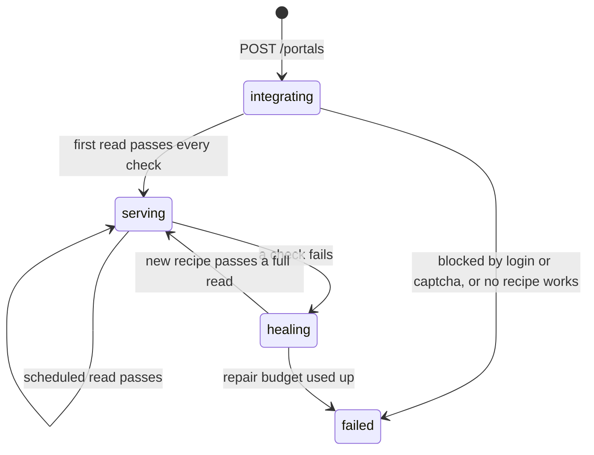
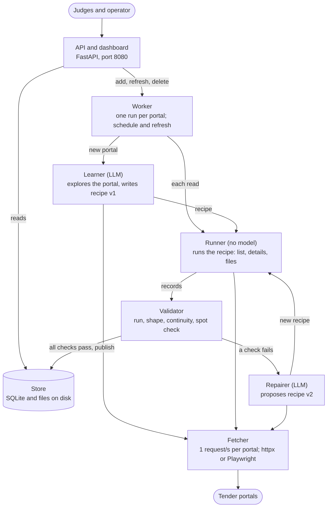

# Watchtower: Design Doc

Patterno track · draft of 2026-11-20

## Context: the Patterno challenge

In 24 hours, as a team of 3 to 4, we build "the Watchtower": an agent that attaches to a public-tender portal it has never seen, notices when that portal stops delivering correctly, and repairs itself. Nobody may help it while it runs.

Patterno collects tenders from more than 4,500 procurement portals in 29 European countries. Today each new portal is connected by hand, and when a portal changes, its tenders can stop arriving without anyone noticing. The winning system goes into production.

Source: [hackathon-pdfs/Patterno-Track-Description.pdf](hackathon-pdfs/Patterno-Track-Description.pdf)

### What is judged

The judges run our container on portals it has never seen: private ones they built for the challenge, and real ones.

| Criterion | What they check |
| --- | --- |
| Attach | Tenders and documents delivered correctly from an unseen portal |
| Notice | The state we report matches what we actually deliver |
| Repair | Correct delivery again after a portal has changed |
| Dashboard | An operator sees which portals deliver, which broke, and what the system did about it |
| Approach | How well it would scale to many more portals, and the model cost per portal |

### Rules that shape the design

- Any language, framework and model. Model keys come from environment variables, named in the README.
- The LLM learns how a portal is read, checks it and repairs it. Regular reads should ideally make no model call.
- No steering: no person and no service of ours may direct the system during the run.
- Politeness: at most 1 request per second per portal, no logins, no captcha solving.

### Hand-in

- A Git repo with a Dockerfile at its root. `docker build .` must work on linux/amd64 and build fairly quickly; the default command serves the API and dashboard on port 8080.
- A one-page README: how it works, the environment variables, and the model cost of one portal.
- A video of at most 3 minutes showing the system at work, dashboard included.

### API contract

Every answer is JSON (except the dashboard and file bytes), with no authentication. Unknown ids answer 404. Times carry an offset, for example `2026-12-09T10:00:00+01:00`.

| Call | Answer |
| --- | --- |
| `POST /portals` `{"url"}` | 201 `{"id"}` at once, attach in the background. The same URL twice returns the same id. |
| `GET /portals`, `GET /portals/{id}` | 200: `id`, `url`, `state`, `reason` in words, `tenderCount`, `lastSuccessAt` or null |
| `DELETE /portals/{id}` | 204. We stop calling the portal within a minute. |
| `POST /portals/{id}/refresh` | 202 `{"runId"}` at once. If a read is already running, return its `runId`. May be called every few minutes. |
| `GET /portals/{id}/tenders` | 200 list of tenders. `?changedSince=` filters on `lastChangedAt`. |
| `GET /portals/{id}/runs` | 200 list: `id`, `kind` (read or repair), `startedAt`, `finishedAt` or null, `result` (ok, failed, null while running). The first attach is a read. |
| `GET /` | The dashboard |

A portal is in one of four states:

| State | Meaning |
| --- | --- |
| `integrating` | Being attached, nothing delivered yet |
| `serving` | Delivering correctly |
| `healing` | Broken, repair running; the last correct tenders are still served |
| `failed` | Cannot deliver, a person is needed. A login or captcha block lands here, with the reason. |

### Tender record

| Field | Required | Notes |
| --- | --- | --- |
| `id` | yes | The portal's own identifier, stable across reads |
| `url` | yes | The tender's page |
| `title` | yes | As the portal states it |
| `buyerName` | yes | The public body buying |
| `publicationDate` | yes | A date, `2026-11-20` |
| `submissionDeadline` | yes | Date and time with offset |
| `status` | yes | `open`, `closed` (deadline passed or no longer listed), `withdrawn` (cancelled) |
| `documents` | yes | `fileName`, `sizeBytes`, `sha256`, and our API path to the bytes (`/files/ab12`). ZIPs unpacked; files over 250 MB may be skipped. |
| `lastChangedAt` | yes | When we last saw the tender change |
| `referenceNumber` | if shown | The buyer's file number |
| `description` | if shown | What is bought |
| `procedureType` | if shown | `open`, `restricted`, `negotiated`, `other` |
| `contractNature` | if shown | `works`, `services`, `supplies` |
| `cpvCodes` | if shown | 8-digit strings, check digit dropped: `45000000` |
| `placeOfPerformance` | if shown | `postalCode`, `city`, `countryCode` (two letters) |

A required field the portal does not show is sent as null; optional ones are left out. A wrong value scores worse than a missing one.

## Problem and users

The problem is not reading one portal; it is that every portal is different, changes without warning, and fails silently. A scraper written by hand for each of 4,500 portals does not scale, and a broken scraper looks the same as a quiet week.

| Who | What they need from us |
| --- | --- |
| Patterno operator | One page each morning: which portals deliver, which broke, what the system already tried, and which need a person |
| Downstream pipeline (the judges' harness during the challenge) | A stable API with exact fields, stable tender ids and honest portal states |
| Patterno, as the business | A per-portal cost in model usage low enough to run across thousands of portals |

Honesty matters as much as coverage. A portal reported as `serving` that delivers wrong or stale tenders is the failure Patterno has today; a portal reported as `failed` with a clear reason is a useful answer.

## Goals and non-goals

We optimise for correct, honestly reported delivery on unseen portals, at a model cost paid once per portal rather than on every read.

**Goals**

1. Attach: from a bare URL, deliver every open tender with its documents, with no human input.
2. Notice: the reported state always matches what we deliver. When in doubt, report `healing` or `failed` rather than `serving`.
3. Repair: after a portal changes, return to correct delivery on our own, and keep serving the last correct tenders meanwhile.
4. Dashboard: one page an operator can read in a minute, showing state, reason and the run history per portal.
5. Cost: the LLM runs only to learn, check and repair a portal. Regular reads make no model call, and we report the cost per portal in tokens and euros.
6. Scale: portals running the same software share what was learned, so cost grows with the number of software packages, not portals.

**Non-goals**

- Logging in or solving captchas. A blocked portal is reported `failed` with the reason.
- Scoring tenders against company profiles, reading documents for content, or helping with bids. That is Patterno's existing product.
- Filling every optional field. We leave out what we are not sure of.
- Multi-user auth, horizontal scaling or a production database. One container, one process, local storage.

## Proposed solution

Learn once, read cheaply, check every read, re-learn on failure. The LLM turns a portal into a **recipe**, a declarative description of how to read it. A deterministic engine runs the recipe on every read with no model call, a validator checks each result, and when the checks fail the LLM repairs the recipe.

### Portal lifecycle

A portal is reported `serving` only while its reads pass every check. A repair that cannot succeed ends in `failed` with its reason, never in a false `serving`.

### The recipe

One versioned JSON document per portal, stored with every run that used it:

- **Source**: how the tender list is fetched. A server-rendered page, a JSON API found in the browser's network traffic, or a page that needs a headless browser.
- **Paging**: next-page link, page parameter or API offset.
- **List and detail fields**: CSS or XPath selectors for HTML, JSON paths for APIs, each with a normaliser (date format and timezone, CPV check digit, status words in the local language).
- **Documents**: how to reach the files. Direct links, a documents tab, or a multi-step download.
- **Expectations**: what a healthy read looks like, used by the validator. Typical tender count, fill rate of each field, sample tender ids.

### Options considered

| Option | How a regular read works | Model calls per read | Verdict |
| --- | --- | --- | --- |
| A. Declarative recipe | Our engine runs selectors and JSON paths from the recipe | 0 | **Recommended**: cheap, inspectable, easy to diff and repair |
| B. Generated code per portal | The LLM writes a Python extractor; we run it in a sandbox | 0 | Fallback for portals the recipe format cannot express |
| C. Agent reads every time | A browser agent drives the portal on each read | Many | Rejected: breaks the "reads without a model" rule, and cost grows with every read |

### Notice: how we decide a read is correct

Each read passes four kinds of check before its tenders replace the last good ones:

1. **Run**: the recipe ran to the end; pages and files returned 2xx.
2. **Shape**: required fields are present at the rate the expectations say, dates parse, the deadline falls after publication, ids match the expected pattern.
3. **Continuity**: ids of tenders still open last time are still found, and the tender count has not dropped sharply. A count the portal prints itself ("23 results") is compared when shown.
4. **Spot check** (at attach and after repair only): the LLM compares a few extracted records with the raw pages and confirms the values.

A failed check moves the portal to `healing` and starts a repair. A login form or captcha in the way of the list or the documents moves it to `failed`, with that reason.

### Repair

The repair agent gets the current recipe, the failing checks, the last good records, and a fresh snapshot of the portal (HTML and captured network calls). It proposes a new recipe version. We swap it in only if a full read with it passes every check, including finding the tenders known to be open. After a fixed budget of attempts, the portal moves to `failed` with what was tried.

### Reuse across portals

Many portals run the same software under different addresses. At attach we fingerprint the software (URL path, footer, page generator) and try recipes learned on other portals of that software first. A hit attaches with only a spot check, which is where the per-portal cost falls toward zero.

## Architecture

One Python process in one container: an async web server for the API and dashboard, and a worker loop in the same process that runs reads and repairs. SQLite and a local file store hold everything; the only external calls are to portals and the LLM.

Only the learner and the repairer call the model; every regular read goes runner → validator without one.

### Stack

| Layer | Choice | Why |
| --- | --- | --- |
| Language | Python 3.12 | Already pinned for this repo |
| API and dashboard | FastAPI, server-rendered HTML that refreshes itself | One process on port 8080, no frontend build step |
| HTTP | httpx (async), one rate limiter per portal | Holds the 1 request per second rule in one place |
| Headless browser | Playwright with Chromium | JavaScript portals, and capturing network calls to find their JSON API |
| HTML parsing | lxml or selectolax | CSS and XPath selectors in recipes |
| Storage | SQLite, files on local disk | No services to run beside the container |
| LLM | OpenAI model, key read from `OPENAI_API_KEY` | Assumed from the repo name; see open questions |
| Container | Playwright's Python base image | Chromium and its system libraries come prebuilt, so `docker build` stays fast |

### Data

- **portals**: url, state, reason, software fingerprint, current recipe version, `lastSuccessAt`.
- **recipes**: every version per portal, with the run that created it and the evidence behind it.
- **runs**: kind (read or repair), times, result, the checks that passed or failed, model tokens used.
- **tenders**: the normalised record, a hash of it to set `lastChangedAt`, and the run that last confirmed it.
- **files**: sha256, size, path on disk. Served at `/files/{id}`; the same file in two tenders is stored once.

### Rules the worker enforces

- One run per portal at a time. A refresh during a read returns that read's `runId`.
- Our own schedule reads each `serving` portal on a fixed interval, as well as on refresh.
- Tenders of the last good read stay published until a new read passes every check.
- `closed` is set when the deadline passes or the portal stops listing the tender; `withdrawn` only when the portal says it was cancelled.
- Files are streamed to disk and hashed as they arrive. A file announced over 250 MB is skipped; ZIPs are unpacked and their entries listed as documents.
- `DELETE` cancels the portal's tasks and removes it from the schedule at once.

## Build plan

Get one portal working end to end through the real API by hour 10, then spend the rest on breadth, repair and honesty. A system that attaches three portals and reports truthfully beats one that half-reads twenty.

### Phases

| Hours | Phase | Work | Gate at the end |
| --- | --- | --- | --- |
| 0–3 | Skeleton | API stubs, Dockerfile, SQLite schema, dashboard shell, test portal list | Every API call answers in the contract's shape |
| 3–10 | Attach | Fetcher, learner, recipe engine, file downloads | One portal `serving` end to end |
| 10–16 | Notice and repair | Validator checks, healing flow, breakable mock portal | Mock portal heals itself after a change |
| 16–21 | Breadth | Full test set, cost per portal, dashboard polish | Every test portal reported honestly |
| 21–24 | Hand-in | README, video, clean `docker build` on linux/amd64 | Submitted |

### Workstreams

| Workstream | Scope | Owner |
| --- | --- | --- |
| Platform | Dockerfile, API contract, SQLite, scheduler, file store, dashboard | |
| Learner | Portal discovery, software fingerprint, recipe format, prompts for learning and repair | |
| Runner and validator | Recipe engine for HTML, JSON APIs and the browser; normalisers; the four checks | |
| Test bench | Test portal set, a mock portal we can break, cost measurement, README, video | |

### Test set

The judges give no list, so we build our own. Starting points: [ted.europa.eu](https://ted.europa.eu) (notices name the portal holding the documents), [oeffentlichevergabe.de](https://oeffentlichevergabe.de), [boamp.fr](https://boamp.fr), [contrataciondelestado.es](https://contrataciondelestado.es), [tenderned.nl](https://tenderned.nl). Search in the local language: "Vergabeplattform Vergabeunterlagen", "marchés publics DCE", "licitaciones pliegos", "przetargi dokumentacja".

- [ ] At least 8 portals, each with a public list and at least 5 open tenders whose documents download without login
- [ ] At least 4 countries and 3 different portal software packages
- [ ] A mix of server-rendered pages, JavaScript apps with a JSON API, and multi-step downloads
- [ ] 1 or 2 portals behind a login or captcha, which must end `failed` with the reason
- [ ] Our own mock portal we can change on purpose (layout, moved field, new paging, renamed API) to test repair
- [ ] 2 portals kept unseen until the final test

### Demo video (3 minutes)

1. Add four portals by URL; the dashboard shows them move from `integrating` to `serving`.
2. Open one portal's tenders and a downloaded document.
3. Change our mock portal live; the dashboard shows `healing`, the repair run, then `serving` again.
4. A captcha portal sits at `failed` with its reason.
5. Close on the model cost per portal, learned once and reused across portals of the same software.

## Open questions and risks

The biggest risk is reporting `serving` while delivering wrong data; most mitigations below exist to keep the reported state honest.

### Open questions

- [ ] Declarative recipes (option A) or LLM-generated scraper code per portal (option B) as the main path?
- [ ] Which LLM provider and model? The stack assumes OpenAI from the repo name.
- [ ] Who is on the team, and who owns each workstream?
- [ ] When do the 24 hours start and end, and when is the video recorded?
- [ ] How do the judges change a private portal during the test: layout, URLs, API, or all of them? Worth asking at mentoring.
- [ ] How often should our own schedule read a portal, given the judges may call refresh every few minutes?
- [ ] Should a `failed` portal be retried on a slow schedule, or stay failed until a person acts?

### Risks

| Risk | What goes wrong | Mitigation |
| --- | --- | --- |
| Silent wrong data | A selector picks a neighbouring field; the record looks plausible | Spot check by the LLM at attach and after repair; leave a field out when unsure |
| Empty is not broken | A portal with no open tenders this week looks like a failed read | Compare with the count the portal prints; check the page still has its list structure |
| Slow attach | At 1 request per second, 200 tenders with detail pages and files take many minutes | Publish tenders as they are read, fetch files after the list; show progress on the dashboard |
| Notice links to a summary | The link in a notice opens a summary page, not the tender | The learner follows through to the page holding the documents |
| Local-time deadlines | A deadline without an offset is read in the wrong zone | Derive the zone from the portal's country; never assume UTC |
| Huge ZIPs | Files over 1 GB fill the disk or stall a read | Check the size before downloading, stream to disk, skip over 250 MB |
| Captcha on the page only | A portal shows a captcha but its files download without it | Mark `failed` only when the captcha actually blocks the list or files |
| Docker build time | Chromium makes the image heavy | Start from Playwright's prebuilt image; keep our own layers small |
| Model cost | Learning large pages costs many tokens | Trim HTML before sending; reuse recipes across portals of the same software; log tokens per run |
