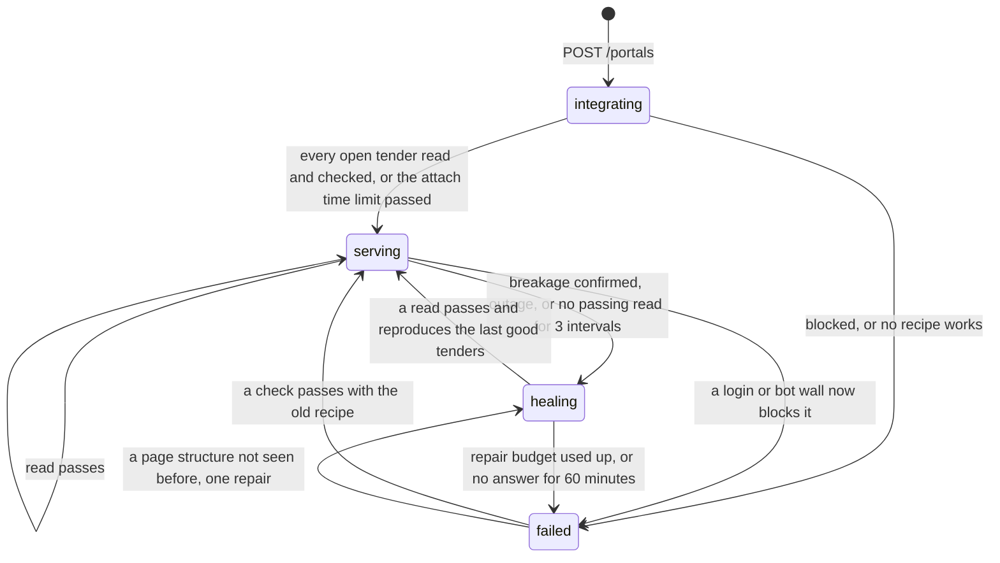
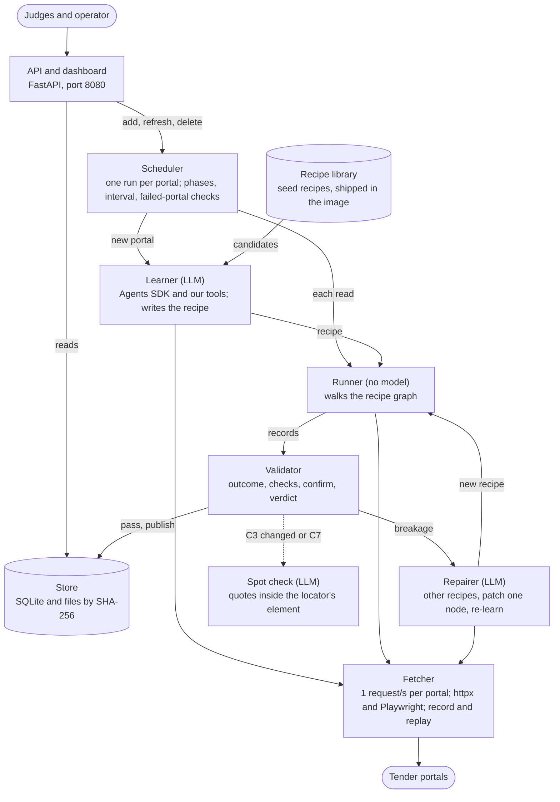

# Watchtower: Design Doc

Patterno track · draft 3 of 2026-11-20 · built from the finished research in `research/`

## How to use this doc

This is the spec the system is built from. Each decision names the research question it comes from (Q1 to Q14); the reasons, the alternatives and every threshold are in `research/qNN-*.md`, and the register is `research/README.md`.

Where this doc and the research disagree, the research wins. Where `research/audit.md` corrects an answer file, the audit wins. The track description and the API contract below win over everything, and so do the mentor's answers in `research/mentor-answers.md`.

## Changes in draft 3

Draft 2's own change list is in git history. This draft brings the doc in line with the answered questions and their end check.

- **Recipe**: a typed navigation graph (Q1), with several locators per field (Q2) and the facts the checks need (Q10, Q11, Q12). (The recipe)
- **Learner**: an agent on the OpenAI Agents SDK with our own tools. It starts from the page's own network calls and links; guessed feed and API paths found nothing and are dropped. (Q3, Q4, Q5 · Attach)
- **Notice**: Q10's rules replace draft 2's percentage thresholds. A suspect read is confirmed or cleared by a second look within seconds, not by waiting for more bad reads. (Notice)
- **Repair**: accepted when the known tenders reproduce under Q10's paired test, not draft 2's 90% rule. A new repair only on a page structure not seen before. (Q10, Q14 · Repair)
- **Failed portals**: checked on every refresh and on a ladder of 5 minutes, 15 minutes, 1 hour, then every 6 hours. (Q14 · Failed portals)
- **Attach and schedule**: a records gate with a 10-minute rule for documents; reads every 2 minutes, or 10 times the list's read time, at most 30 minutes. (Q12, Q13 · Read order, schedule and budget)
- **Politeness**: one rate limiter per portal, not per host. Redirect hops and WebSockets get past `page.route`, so they are handled outside it. (audit of Q4 · Stack)
- **Reuse**: a portal is also matched to stored recipes by its page structure; Patterno's own portal list sizes the Approach argument. (Q11, audit of Q11 · Reuse)
- **Cost**: prices from Q9. The cost per portal is quoted only once measured; it holds only if the learner trims its context. (audit of Q9 · Cost per portal)
- **Build plan**: AI agents build the system, one module each, behind tests. (Build plan)
- **The mentor's answers of 20 November**: a partial result when the attach time limit passes, documents listed while they load, a `cause` field on a portal, robots.txt obeyed with a test switch, a date-only deadline read as end of day, and a test set that leads with non-German portals. (`research/mentor-answers.md`)

## Context: the Patterno challenge

In 24 hours, as a team of 3 to 4, we build "the Watchtower": an agent that attaches to a public-tender portal it has never seen, notices when that portal stops delivering correctly, and repairs itself. Nobody may help it while it runs.

Patterno collects tenders from more than 4,500 procurement portals in 29 European countries. Today each new portal is connected by hand, and when a portal changes, its tenders can stop arriving without anyone noticing. The winning system goes into production.

Source: [hackathon-pdfs/Patterno-Track-Description.pdf](hackathon-pdfs/Patterno-Track-Description.pdf)

### What is judged

The judges run our container on portals it has never seen: private ones they built for the challenge, and real ones.

| Criterion | What they check |
| --- | --- |
| Attach | Tenders and documents delivered correctly from an unseen portal |
| Notice | The state we report matches what we actually deliver |
| Repair | Correct delivery again after a portal has changed |
| Dashboard | An operator sees which portals deliver, which broke, and what the system did about it |
| Approach | How well it would scale to many more portals, and the model cost per portal |

### Rules that shape the design

- Any language, framework and model. Model keys come from environment variables, are named in the README, and their values are given to the judges at hand-in.
- The LLM learns how a portal is read, checks it and repairs it. Regular reads should ideally make no model call.
- No steering: no person and no service of ours may direct the system during the run. Everything it needs ships in the image.
- Politeness: at most 1 request per second per portal, no logins, no captcha solving.

### Hand-in

- A Git repo with a Dockerfile at its root, linked in the hackathon submission. `docker build .` must work on linux/amd64 and build relatively quickly on small to medium machines; the default command serves the API and dashboard on port 8080.
- A one-page README: how it works, the environment variables, and the model cost of one portal.
- A video of at most 3 minutes showing the system at work, dashboard included.
- The values of the model keys, for the judges to run the container with.
- A signed participant declaration from each member. It is a condition for the prize and the final, and gives Patterno an exclusive licence on what we build, so the repo carries no open-source licence. Source: [hackathon-pdfs/Patterno_Participant_Declaration_MAIN_2026.pdf](hackathon-pdfs/Patterno_Participant_Declaration_MAIN_2026.pdf)

Deadline: Saturday 21 November 2026, 10:30.

### API contract

Every answer is JSON (except the dashboard and file bytes), with no authentication. A list is a bare JSON array, not an object wrapping one. Unknown ids answer 404. Times carry an offset, for example `2026-12-09T10:00:00+01:00`.

| Call | Answer |
| --- | --- |
| `POST /portals` `{"url"}` | 201 `{"id"}` at once, attach in the background. The same URL twice returns the same id. |
| `GET /portals`, `GET /portals/{id}` | 200: `id`, `url`, `state`, `reason` in words, `tenderCount`, `lastSuccessAt` or null |
| `DELETE /portals/{id}` | 204. We stop calling the portal within a minute. |
| `POST /portals/{id}/refresh` | 202 `{"runId"}` at once. If a read is already running, return its `runId`. May be called every few minutes. |
| `GET /portals/{id}/tenders` | 200 list of tenders. `?changedSince=` keeps only tenders whose `lastChangedAt` is later. |
| `GET /portals/{id}/runs` | 200 list: `id`, `kind` (read or repair), `startedAt`, `finishedAt` or null, `result` (ok, failed, null while running). The first attach is a read. |
| `GET /files/{id}` | The bytes of one document. The route is ours; each document's `path` points to it. |
| `GET /` | The dashboard |

A portal is in one of four states:

| State | Meaning |
| --- | --- |
| `integrating` | Being attached, nothing delivered yet |
| `serving` | Delivering correctly |
| `healing` | Broken, repair running; the last correct tenders are still served |
| `failed` | Cannot deliver, a person is needed. A login or captcha block lands here, with the reason. |

### Where the brief is silent

The brief leaves these open. We decide them once, here, so every part is built the same way.

- **Portal id.** Derived from the normalised URL (scheme and host in lower case, no fragment, no trailing slash), so the same address always gives the same id, also after a restart. A repeated `POST` answers 201 with that id.
- **After a delete.** The id is unknown again and every route under it answers 404. Its tenders and files are removed. Adding the address again starts a fresh attach under the same id.
- **`reason`.** Always a sentence, also when all is well: "Read at 14:02 found 23 open tenders, 2 new and 1 closed. Every check passed."
- **`tenderCount`.** The length of the tenders list, closed and withdrawn tenders included.
- **Tenders while `integrating`.** 200 with `[]`.
- **Documents not fetched yet.** A document we know of is listed with its name and announced size, and its `sha256` and `path` are null until its bytes are in. `documents` itself is null when not even the list is known, never `[]`: an empty list says the tender has no documents (Q12; the mentor is fine with documents that are mapped and still loading).
- **`changedSince`.** A `+` in the offset arrives as a space when the caller does not percent-encode it; we accept both. A value we cannot parse answers 400.
- **Refresh during a repair.** Answers with the repair's `runId`. A repair run ends with a full verifying read and publishes on success, so when that run finishes the tenders are fresh.
- **Refresh on a `failed` portal.** Checks it at once with the old recipe, at most once a minute. The check makes no model call; it starts a repair only when the page structure is one we have not seen before (Q14).
- **Extra fields.** We add our own fields to runs and portals (cost, failed checks, a summary in words). We never rename or drop one from the contract. A portal that is not `serving` also carries `cause`: `outage`, `block` or `breakage`, so the three can be told apart without reading the reason. The mentor confirmed that adding to the interface is fine as long as its schema is kept.
- **A deadline shown as a date with no time** is the end of that day in the portal's zone. The mentor called that technically right, and without a deadline we could not tell `open` from `closed`. A setting can make it null instead.
- **robots.txt** is read before the first request to a portal and obeyed. A portal that forbids every path is `failed` with that reason. A setting, off by default, ignores robots.txt for a test; the mentor asked for it. Captchas are never bypassed.

### Tender record

| Field | Required | Notes |
| --- | --- | --- |
| `id` | yes | The portal's own identifier, stable across reads |
| `url` | yes | The tender's page |
| `title` | yes | As the portal states it |
| `buyerName` | yes | The public body buying |
| `publicationDate` | yes | A date, `2026-11-20` |
| `submissionDeadline` | yes | Date and time with offset |
| `status` | yes | `open`, `closed` (deadline passed or no longer listed), `withdrawn` (cancelled) |
| `documents` | yes | A list. Each file has `fileName`, `sizeBytes`, `sha256` and `path`, our API path to the bytes (`/files/ab12`). ZIPs unpacked; a file over 250 MB, a ZIP included, may be left out. |
| `lastChangedAt` | yes | When we last saw the tender change |
| `referenceNumber` | if shown | The buyer's file number |
| `description` | if shown | What is bought |
| `procedureType` | if shown | `open`, `restricted`, `negotiated`, `other` |
| `contractNature` | if shown | `works`, `services`, `supplies` |
| `cpvCodes` | if shown | A list of 8-digit strings, check digit dropped: `45000000` |
| `placeOfPerformance` | if shown | `postalCode`, `city`, `countryCode` (two letters) |

A required field the portal does not show is sent as null; optional ones are left out. A wrong value scores worse than a missing one.

## Problem and users

The problem is not reading one portal; it is that every portal is different, changes without warning, and fails silently. A scraper written by hand for each of 4,500 portals does not scale, and a broken scraper looks the same as a quiet week.

| Who | What they need from us |
| --- | --- |
| Patterno operator | One page each morning: which portals deliver, which broke, what the system already tried, and which need a person |
| Downstream pipeline (the judges' harness during the challenge) | A stable API with exact fields, stable tender ids and honest portal states |
| Patterno, as the business | A per-portal cost in model usage low enough to run across thousands of portals |

Honesty matters as much as coverage. A portal reported as `serving` that delivers wrong or stale tenders is the failure Patterno has today; a portal reported as `failed` with a clear reason is a useful answer.

## Goals and non-goals

We optimise for correct, honestly reported delivery on unseen portals, at a model cost paid once per portal rather than on every read.

**Goals**

1. Attach: from a bare URL, deliver every open tender with its documents, with no human input.
2. Notice: the reported state always matches what we deliver. When in doubt, report `healing` or `failed` rather than `serving`.
3. Repair: after a portal changes, return to correct delivery on our own, and keep serving the last correct tenders meanwhile.
4. Dashboard: one page an operator can read in a minute, showing state, reason and the run history per portal.
5. Cost: the LLM runs only to learn, check and repair a portal. Regular reads make no model call, and we report the cost per portal in tokens and euros.
6. Scale: portals running the same software share what was learned, so cost grows with the number of software packages, not portals.

**Non-goals**

- Logging in or solving captchas. A blocked portal is reported `failed` with the reason.
- Scoring tenders against company profiles, reading documents for content, or helping with bids. That is Patterno's existing product.
- Filling every optional field. We leave out what we are not sure of.
- Multi-user auth, horizontal scaling or a production database. One container, one process, local storage.

## Proposed solution

Learn once, read cheaply, check every read, re-learn on failure. The LLM turns a portal into a **recipe**, a declarative description of how to read it. A deterministic engine runs the recipe on every read with no model call, a validator checks each result, and when the checks find a breakage the LLM repairs the recipe.

### Portal lifecycle

A portal is reported `serving` only while its reads pass every check. `healing` covers both a repair and an outage; an outage never starts a repair. `failed` is not final: the portal keeps being checked, and one that comes back is served again (Q14).

### The recipe

One versioned JSON document per portal, validated against a Pydantic schema and stored with every run that used it. It is a **typed navigation graph** (Q1): flat `nodes` and `edges` arrays that refer to node ids, written by the model through OpenAI's strict structured output. Strict output means no maps with free keys, no nesting beyond what the schema names, and only the node kinds and actions in the closed sets below (audit of Q1).

- **Node kinds** (closed set): an HTML page, a JSON API, a browser state, a feed, a documents node, a reference to another platform's recipe for documents held elsewhere, and `custom_code`. A JavaScript app becomes a JSON API node once its API is found. `custom_code` is generated Python, run in a sandbox, and allowed only as a rare escape hatch.
- **Actions** (closed set): follow a link, next page, call an API (GET, or POST with a query in the body), submit a form, for each item, download. Cookies are kept for the session, and hidden form fields are carried from one step to the next, because some portals page through form posts. A multi-step document download is a chain of these actions (audit of Q1).
- **Paging**: next-page link, page parameter, API offset or cursor, form post, or a "load more" button; for an API, the page-size parameter and its maximum (Q12).
- **Identity**: where a tender's `id` comes from, and its learned shape. It must be an identifier the portal issues, never a row position or a hash of ours. When it appears both in the URL and on the page, the two must agree (Q2).
- **Fields** (Q2): each field holds two or three locators and a value spec. Preference: JSON path, then a label anchor ("Angebotsfrist"), then a relative CSS or XPath on ids, attributes or text; never an absolute XPath, an `nth-child` position or a default value. The value spec parses and normalises: date format and the zone of the portal's country, CPV, status and procedure words in the local language mapped to the contract's values.
- **What the checks read** (Q10, Q12): the locator of the printed total and whether it counts closed tenders; the empty-state marker learned at attach; the structure fingerprint of list and detail pages with this portal's floor; whether the list alone carries every required field; whether an all-documents ZIP exists; the portal's own change marks. The portal's time zone is not in the recipe: it lives on the portal record (`Portal.timezone`).
- **Family and host** (Q11): the software family, a block of per-host settings (page size, filters, language), and the canary used when the recipe is reused elsewhere.
- **Expectations**: fill rate of each field and the id pattern, updated after every passing read.

### Options considered

| Option | How a regular read works | Model calls per read | Verdict |
| --- | --- | --- | --- |
| A. Typed navigation graph | Our engine walks the nodes and runs their locators | 0 | **Chosen** (Q1). Reaches summary pages, form-post paging and multi-step downloads; a repair patches one node; the model fills one closed schema. |
| A′. Fixed stages (draft 2) | Our engine fills fixed slots: source, paging, fields, documents | 0 | Not chosen. Its series of GET and POST steps can reach an extra hop, but every new kind of hop needs another flag; the graph names them once. The audit notes this comparison was argued, not tested. |
| B. Generated code per portal | The LLM writes a Python extractor; we run it in a sandbox | 0 | Escape hatch only, as a `custom_code` node. Code can run green while reading the wrong field, and its repairs are harder to verify. |
| C. Agent reads every time | A browser agent drives the portal on each read | Many | Rejected: breaks the "reads without a model" rule, and cost grows with every read |

Decision point once the mock portal and the first real portals run end to end: if the node kinds cannot express at least half of the test set, add `custom_code` nodes for those portals and nothing else.

### Attach: how the learner works

The learner is an agent on the OpenAI Agents SDK (Q5) with our own tools (Q4). It returns the recipe as a validated Pydantic object. Three things the SDK does not do, so our runner does them (audit of Q5, Q9):

- **Trim the context on every call.** One learn costs about $1.68 on `gpt-6.2-sol` if each call stays near 30K input tokens, and about $7.74 if every tool result is appended to one growing conversation.
- **Stop on budget from outside the tool.** A tool that raises when the budget is gone does not stop an SDK run; the model just carries on to `max_turns`.
- **Retry invalid output once** with the validation message. A second failure ends the run as failed.

Always name the model and set `max_turns`; the SDK's default is 10.

Steps:

1. **Use what the portal itself offers** (Q3): JSON calls in the entry page's network traffic, links to feeds the pages carry, app state embedded in the page. Guessing paths such as `/feed`, `/rss` or `/api` found nothing in 32 tries on four portals (audit of Q3), so it is the last resort, not a step. A source counts only when it belongs to the portal we were given: a national feed or TED is a cross-check, never the source of ids or documents (Q11). For an API, raise the page size until the API refuses (Q12).
2. **Match a stored recipe** before learning. See Reuse across portals.
3. **Explore toward the list.** The entry may be a home page, a list or a summary page. Follow the portal's own links with a page budget (a setting). Never crawl the whole site to map it: TenderNed's sitemap alone lists about 95,000 historical notices (audit of Q3).
4. **Write the recipe, testing as it goes.** The agent tries each locator on cached pages before committing to it, at no request cost. Locators are learned on two or three detail pages, never one (Q2). A search that returns nothing is run once to learn the empty-state marker (Q10). The recipe is dry-run on the cached pages before the first live read.
5. **Look for a block.** Only the outcome counts (Notice, step 2). A captcha shown while the list and files arrive anyway is not a block.
6. **Spot check, then the first full read** under the records gate (Read order, schedule and budget).

**Tools** (Q4): open a page and summarise its JSON network calls; view a page; list links grouped by URL pattern; act on the page (click, fill, submit) and report the network calls it caused; fetch an API through httpx; test a locator on cached pages; download a file; propose and patch the recipe, checked against the schema. Every page is cached to disk the first time it is fetched.

**What the model sees** (Q4, measured on real portals): trimmed HTML, about 4K tokens for a 50-row list against 49K raw. Scripts, styles and SVG go; `id`, `class`, `href`, `src`, `name`, `role`, `aria-label` and every `data-*` attribute stay, because recipes are written against them and some portals link their rows only through `data-*` (vmstart). Repeated rows are cut to three on list pages only, never on detail pages, where the cut removed the deadline. JSON is shown with its arrays cut to three items and a count. The spot check reads markdown or plain text of the same page, never to find locators.

### Notice: how we decide a read is correct

From Q10. A read is judged by evidence that does not depend on how many tenders exist today, and no single statistic changes the state on its own. Cheap checks mark a read *suspect*; a second, deterministic look in the same run confirms or clears it within seconds and without a model call. Only then does the state change. Every threshold below is a setting; their derivations are in Q10.

**Step 1: did each request get an answer?**

- **T1**: timeout, DNS or TLS failure, connection reset, HTTP 408, 500, 502, 503, 504, 520 to 524. Up to 3 tries with randomised, growing pauses; a `Retry-After` of up to 60 s is obeyed in place. Persists: **Outage**.
- **T2**: 429, or a 403 or 503 carrying `Retry-After`. Halve this portal's request rate, down to one request per 10 seconds, and keep the slower rate. A 403 can be a rate limit: Poland's national portal answers 403 above 30 requests a minute.
- **T4**: a certificate that does not verify. Never switch verification off; try the page once through the browser, which completes chains a plain client does not.

**Step 2: did what we asked for arrive?** The presence of a captcha script, widget or cookie is never a reason; only the outcome counts.

- **O1 list**: the row locator matches, or the list is provably empty (a printed total of 0, the empty-state marker, an API answering its usual keys with an empty list).
- **O2 file**: 2xx, not an HTML page, first bytes fit the type (`%PDF`; `PK\x03\x04` for ZIP, DOCX, XLSX; `D0 CF 11 E0` for old Office files), size above 0 and equal to the announced size. A login page served with 200 in place of a file is a **Block** and is never stored.
- **robots.txt** is obeyed. A portal that disallows every path is a **Block** with that reason, unless the test switch is on (the mentor's answer).
- When the outcome is missing and a block sign is present (a redirect to a login, a password field where a list was expected, `cf-mitigated: challenge`, an AWS WAF 202 or 405 on a non-page request, "Request Rejected", an Imperva frame, a 401, a 403 that persists in the browser too), fetch once more, through the browser if plain HTTP was used. Still blocked: **Block**. A maintenance page: **Outage**. The browser try is made once per incident: one page load of a JavaScript app can cost about 90 requests.

**Step 3: is what we extracted right?** No model.

| Rule | Check | Outcome |
| --- | --- | --- |
| C1 complete | Paging reached its end; no id twice; when the portal prints a total, exactly that many, after one re-read of the list | **Breakage** |
| C2 shape | Every value parses; the id has its learned shape; the deadline is after publication; codes and enums hold; no value contains markup | The value is sent as null, never published wrong; it counts as lost in C3 |
| C3 known tenders reproduce | For tenders in this read and the last good one: how many lost a required value, how many changed one. Thresholds for 3, 10, 50, 500 known tenders: 2, 3, 5, 14 lost; 3, 3, 6, 22 changed. | Lost: suspect, confirm. Changed: spot check. |
| C4 known open tenders still listed | Tenders open with a deadline ahead that are now absent: look at up to 5 of their detail pages. When 3, 5, 9 or 42 are missing for 3, 10, 50, 500 known, the list's structure must also be intact or the printed total agree. | One still open, or the extra condition fails: **Breakage**. All closed or withdrawn: accept and set the status. |
| C5 new tenders as complete | Nulls per required field among new rows against earlier good rows, Fisher's exact test at 1 in 1,000 | Suspect, confirm |
| C6 canary | Two known detail pages and one known file are fetched again on every read | Fails twice: **Breakage** |
| C7 structure | The sorted set of tag-and-class paths (key paths for JSON), ignoring text, row positions and numeric ids, differs from the stored one by more than this portal's floor | Spot check; never a failure alone |
| D1 files | Failed files against the failure share of earlier good reads, exact test at 1 in 1,000; always when every file fails | Below: publish the rest, log the failures on the run. Above: by cause. |
| F1 age | `serving`, and no read has passed for 3 read intervals | `healing`, "no successful read since …" |

**Field-level rule** (Q2, with the audit's fix). Each field's locators run on every read. Agreement after parsing: accept. Disagreement: null, flagged `conflict`. A single surviving locator is accepted only when its value equals the last good value for the same tender; otherwise null. Many single survivors in one read count as lost values in C3. Locators written by one model from one page are not independent witnesses, so agreement that counts comes from different sources: list row against detail page, page against the portal's API, this read against the last good one. The raw extracted string must appear in the fetched page before it is normalised.

**Step 4: confirm.** A suspect read repeats the part that failed at once (the list, or the affected detail pages), and C4's detail-page look runs. Clean the second time: the read passes, and the first observation is logged as a suspect that cleared. Repeated: the read has failed. A handful of requests, no tokens.

**Spot check.** One small model call, at attach, after a repair, and when C3 (changed) or C7 fires. The model quotes the passage that supports each value; we confirm by string match that the quote is on the page **and inside the element the field's locator read from** (Q11, audit of Q2). A required field it cannot support fails the check: **Breakage**.

**Step 5: verdict.**

| Verdict | State | Model tokens | Example reason |
| --- | --- | --- | --- |
| Pass | `serving` | none | "Read at 14:02 found 23 open tenders, 2 new and 1 closed. Every check passed." |
| Pass, empty | `serving` | none | "The portal lists no open tenders at 14:02. Its own 'no results' notice is shown, and the 4 tenders we knew are closed." |
| Outage | `healing` at once; `failed` after 60 minutes without an answer | none | "The portal has not answered since 14:07 (HTTP 503, three tries). Still delivering the 23 tenders read at 14:02. Next try 14:09." |
| Block | `failed` at once, after one confirming fetch | none | "Login required: the tender list redirects to /anmelden and shows a password field. We do not log in." |
| Breakage | `healing`, repair starts | yes | "The list reads 9 tenders but the portal prints 23, also on a second read. Repairing; still delivering the 23 tenders read at 14:02." |
| Breakage, budget used | `failed` | none after | "The layout changed at 14:07. Three repair attempts failed (list locator, paging, full re-learn). A person is needed." |
| Stale | `healing` | none | "No read has passed since 13:20. Reads are not completing." |

A failed check keeps the last good tenders published.

### Repair

Only a **Breakage** starts a repair; an outage or a block never does. Cheapest step first, each tried only if the one before did not pass:

1. **Try other stored recipes**: those of the same software family, and those whose stored structure fingerprint matches the portal's new pages (Q11).
2. **Patch.** The model gets the current recipe, the failing checks, the last good records and a fresh snapshot (pages and network log), and returns a patch to one node (Q1). A locator found by similarity matching is only a proposal to the model, never accepted on its own (Q2).
3. **Learn again from scratch**, with the rejected recipe handed to the learner as a draft (Q11).

**Acceptance.** A new recipe is swapped in only if a full read with it passes every check and the known tenders reproduce against the last good read under C3 and C4: the same ids, values within C3's thresholds (Q10). If the values match but the ids do not, the recipe took the id from the wrong place; it is rejected and retried with that hint. A spot check follows.

**Budget.** At most three model-backed attempts and a token cap per incident; then `failed`, with what was tried. A new repair starts only on a page structure not seen before, at most three per portal per day, so refresh calls cannot buy repairs (Q14).

**What the run records.** The parts of the recipe that changed, taken from the diff, and one sentence in words: "The deadline moved from the fourth column to a labelled field." The dashboard shows both.

### Failed portals

From Q14. Checks cost no model call.

- **On every refresh** a failed portal is checked at once, at most once a minute.
- **On our own** we check 5 minutes, 15 minutes and 1 hour after it failed, then every 6 hours, each shifted by up to 20% at random. A portal behind a login or bot wall is checked every 6 hours from the start.
- **Before an outage becomes `failed`**, the portal is retried after 1, 2, 4, 8, 15 and 30 minutes while it reads `healing`.

| The check finds | What happens |
| --- | --- |
| The old recipe's read passes every check | `serving` |
| Still blocked, or still not answering | Stays `failed`; the reason gets the time of this check |
| The read fails on a page structure we already gave up on | Stays `failed` |
| The read fails on a page structure not seen before | One repair attempt |

### Read order, schedule and budget

At 1 request per second, requests are the budget. From Q12 and Q13.

**First attach.**

1. **Take the cheapest source the portal itself offers**: a JSON API, a feed, an all-documents ZIP per tender. On TenderNed this cuts the attach by a factor of five.
2. **List phase**: every list page. This gives the count for progress and the deadlines for ordering.
3. **Record phase**: every detail page the recipe needs (none when the list carries every required field), each record validated. This is the **records gate**.
4. **Document phase**: soonest deadline first, smallest tender first among equals; one ZIP per tender where offered. A file over 250 MB is left out.

| Phase | State | `GET /tenders` | `reason` |
| --- | --- | --- | --- |
| List and record phases | `integrating` | `[]` | "Reading tender 420 of 1,000." |
| The attach time limit passes while still `integrating` | `serving` | the tenders validated so far | "Delivering 400 of about 1,000 open tenders so far. The rest follow by 15:10." |
| Gate reached, documents need 10 minutes or less | `integrating` | `[]` | "All 38 tenders read. Fetching documents: 12 of 38." |
| Gate reached, documents need longer | `serving` | every tender; each known document listed, with `sha256` and `path` null until its bytes are in | "All 1,000 open tenders are delivered. Documents are in for 140 of them, soonest deadlines first; the rest follow by 16:40." |
| Everything in | `serving` | complete | "Read at 14:02 found 1,000 open tenders. Every check passed." |

The mentor can wait 20 to 30 minutes per portal, does not want all or nothing at the limit ("we would want to see some kind of results up until then"), and is fine with documents that are listed but still loading (`research/mentor-answers.md`). So the attach time limit is 20 minutes and the document rule stays at 10; both are settings. The size of the test portals was not disclosed.

| Portal (measured or computed in Q12) | Requests | Every record known | Everything in |
| --- | --- | --- | --- |
| HTML list of 20, 100 tenders, 9 files each | 1,005 | 2 min | 17 min |
| HTML list of 20, 1,000 tenders, 9 files each | 10,050 | 18 min | 2.8 h |
| TenderNed today: 1,551 open tenders, API and one ZIP per tender | 3,179 | seconds | 53 min (about 35 GB) |

**After the first attach, incremental.** Each read takes the list again; reads detail pages and documents for tenders that are new or whose list row changed; follows the portal's own change marks where they exist. A file is fetched again only when its entry in the tender's document list changed. Known tenders' detail pages are re-read in an even rotation that may use a fifth of the request budget, those closing within 48 hours first: on a portal of 24 tenders, every detail page on every read.

**Schedule** (Q13). Each serving portal's list is read every **2 minutes, or 10 times as long as the list takes to read if that is more, and at least every 30 minutes**. The interval is the longest a broken portal can be reported `serving`. A list longer than 12 pages that is sorted newest first also has its first page read alone every 2 minutes. A refresh starts the same read at once, or returns the running read's `runId`. `READ_INTERVAL_SECONDS` sets the floor.

**Limits the portal states win.** The limiter starts at one request per second and slows down when the portal says so (T2).

**Disk.** Files are kept under their SHA-256, so the same file in two tenders is stored once. Plan for about 20 MB per tender (one portal, 40 tenders measured; the median is under 3 MB). When space runs low, stop fetching new documents, leave those `documents` null, say so in `reason`, and remove closed tenders' files first.

### Reuse across portals

From Q11 and Patterno's own portal list (`research/patterno-landscape.md`).

- **Why it matters.** Patterno covers 4,657 portals; of the 4,286 portal addresses it lists, the ten largest platforms hold half (`ezamawiajacy.pl`, `e-marchespublics.com`, `logintrade.net`, `acquistitelematici.it`, `tuttogare.it`, and others), and Italy and Poland together are half the list. A recipe per large platform covers up to half of Patterno's portals: that is the Approach argument. 1,229 platforms have a single address and each needs its own learning.
- **Candidates**, with no model call: any match on host, URL path or brand text in the title or footer; and any stored recipe whose structure fingerprint matches the new portal's pages, which is the only signal a test portal built from the same template as an earlier one carries (audit of Q11). A fingerprint is a hint, never a key: one platform can run different versions for different buyers, and a URL path such as `/NetServer/` is not proof of one vendor.
- **Trust.** A candidate must pass a canary read, one list page and five detail pages with every deterministic check; then the full first read, which does the real check; then one spot check. Fail: triage first, then the other candidates, then a cold learn with the rejected recipe as a draft.
- **Documents held elsewhere.** A portal whose documents sit on another platform reaches them through a reference node and reuses that platform's recipe (Q1).
- **Seed library.** The judges start a fresh container and no service of ours may feed it, so the recipes we learn on our test set ship in the image, committed to the repo as JSON. Recipes learned at run time join the same library.

### Cost per portal

Models from Q9, on the Responses API; the benchmark and the price decide between them.

| Job | Model | USD per 1M tokens: input / cached / output |
| --- | --- | --- |
| Learn, repair | `gpt-6.2-sol` | 2 / 0.10 / 10 |
| Learn, repair (benchmarked against it) | `gpt-6.1-terra` | 1 / 0.05 / 5 |
| Spot check | `gpt-6-luna` | 0.10 / 0.01 / 0.50 |

A request over 272K input tokens is billed at twice the input and 1.5 times the output rate for the whole request, which is one more reason the learner trims its context.

The README quotes only measured numbers (audit of Q9). The estimates below hold only if every learner call stays near 30K input tokens.

| Case | Model calls | Estimate (Q9) | Measured |
| --- | --- | --- | --- |
| Attach, new software | Learner rounds and one spot check | about $1.68 on Sol, $0.84 on Terra; $7.74 on Sol if the context grows uncached | to be measured |
| Attach, known software | One spot check | about $0.003 | to be measured |
| Regular read | None | $0 | 0 |
| Read with C3 changed or C7 | One spot check | about $0.003 | to be measured |
| Repair | One to three attempts and one spot check | about $0.70 an attempt on Sol | to be measured |

## Architecture

One Python process in one container: an async web server for the API and dashboard, and a worker loop in the same process that runs reads and repairs. SQLite and a local file store hold everything; the only external calls are to portals and the model.

Only the learner, the repairer and the spot check call the model. A regular read of an unchanged portal goes runner → validator without one.

### Stack

| Layer | Choice | Why |
| --- | --- | --- |
| Language | Python 3.12 for everything; no TypeScript part (Q6) | XPath parsing, Polish dates, ZIP and SQLite are stronger or built in; per-page work is at most 6% of the 1-second wait |
| API and dashboard | FastAPI, server-rendered HTML (Jinja2) that refreshes itself | One process on port 8080, no frontend build step |
| Schemas | Pydantic, in `app/models.py` (Q7) | One definition validates API answers, records, recipes and the model's strict output |
| Agents | OpenAI Agents SDK on the Responses API; our own loop on the `openai` package as the fallback (Q5) | Context trimming, the budget stop and the output retry are ours (Attach) |
| Models | From config: `MODEL_LEARN`, `MODEL_REPAIR`, `MODEL_CHECK`; key from `OPENAI_API_KEY` (Q9) | See Cost per portal |
| HTTP | httpx (async), one rate limiter per portal | Per portal, not per host: a portal's files often sit on a second host. Our client walks redirects itself, one hop per request slot, and sends the browser to the final address; recipes store final addresses (audit of Q4). |
| Headless browser | Playwright for Python, pinned to the base image's version (Q6) | Every request goes through `context.route` to the limiter. Images, fonts, styles, media and third-party origins are blocked; same-origin scripts are served from a cache after their first load; service workers are off; WebSockets are blocked with `route_web_socket` unless a recipe needs one; files are downloaded with httpx using the browser's cookies (Q4). Used to learn, and at read time only for browser-state nodes. At most two pages at a time: two tabs measured 592 MB (Q6). |
| HTML parsing | lxml, CSS and XPath | Q2's locators use both (Q6) |
| Dates and zones | dateparser (DE, FR, ES, NL, PL, IT); `zoneinfo` with the `tzdata` package | Deadlines get the zone of the portal's country by name (`Europe/Berlin`), never a fixed offset and never UTC |
| ZIP | Standard library `zipfile` | ZIP64 and streamed entries; the unpacked-size cap is ours (Q6) |
| Storage | SQLite (standard library); files on local disk under `DATA_DIR` (Q15) | No services beside the container. The recipe graph is a JSON document in `recipes`; no graph database (Q15). |
| Container | `mcr.microsoft.com/playwright/python:v1.65.2-noble` | Chromium comes prebuilt; our layers built in 24 s cold, 4 s after a code change; the image is about 2.7 GB (Q6). Built in CI on every pull request. |

### Data

The records and tables are in `app/models.py` and `app/schema.sql` (Q7): API models that produce the contract's answers exactly, and internal records that map one to one onto the tables (portals, recipes, runs, run_checks, agent_steps, snapshots, tenders, files, tender_files, and a `portal_costs` view).

What the research needs added (audit of Q7):

- **An outage**: `healing` without a repair. `Severity` gets an `outage` value (Q10).
- **A tender whose documents are not in yet**: `documents` nullable in the API model, and a document entry whose `sha256` and `path` are null while its bytes load (Q12, the mentor's answer).
- **`cause`** on a portal that is not `serving`: outage, block or breakage (the mentor's answer).
- **What a failed portal remembers**: the page structure we gave up on, the time of the next check, today's repair count; and a per-portal request rate for portals that state their own limit (Q14, Q10).
- **Read bookkeeping**: a hash of each tender's list row, and a place to hold records before the gate (Q12).
- **Check results** as Q10 names them, including a suspect that cleared (a passed row, severity `info`, the first observation in `observed`), and room for a first observation and its confirmation in one run.
- **`pyproject.toml`**, which does not exist yet although `app/models.py` needs pydantic.

### Rules the worker enforces

- One run per portal at a time. A refresh during a run returns that run's `runId`.
- Portals run side by side. Twenty portals added at once all make progress; browser pages are capped at two at a time, model calls at four.
- One request may start per second per portal, counting every request to the portal's hosts, redirect hops and browser sub-requests included.
- The API answers at once, always. Parsing, hashing and unzipping run in threads, off the event loop.
- Database access does not fan out over threads: four threads reading SQLite through their own connections in one process took 130 ms a query against 2.3 ms for one (Q15). API routes are `async def` and make every store call on one database thread (`app/main.py`). The store (`app/db.py`) also holds one connection for reads and one for writes, each behind a lock, so the worker's threads can call it too without that slowdown: throughput stays flat as threads are added. Long scans such as the fingerprint match run in the worker.
- After a restart, runs left open are closed as failed and their portals queued again.
- Tenders of the last good read stay published until a new read passes every check.
- `closed` is set when the deadline passes or a passing read no longer lists the tender and its detail page confirms it (C4); `withdrawn` only when the portal says it was cancelled. The deadline is watched by a clock, not only by reads, and the change sets `lastChangedAt`, so a `changedSince` caller sees it.
- Files are streamed to disk and hashed as they arrive. A file announced over 250 MB is skipped; one that passes 250 MB while streaming is dropped.
- ZIPs are unpacked, nested ones too, and their entries listed in place of the ZIP. Entries are stored under their hash, never under the name inside the archive, and the unpacked total is capped.
- `DELETE` cancels the portal's tasks and removes it from the schedule at once.

## Dashboard

One server-rendered page at `/`, reading the same store as the API, so the two cannot disagree. It answers the three things the judges name: which portals deliver, which broke, and what the system did about it.

- **Top line**: the number of portals in each state, and the model cost so far.
- **Portal table**, the ones needing attention first: `failed`, `healing`, `integrating`, `serving`. Each row has state, reason, tender count, the age of the last success ("12 minutes ago"), the last run's result and the portal's model cost.
- **Per portal**: the run timeline. Every read and repair with its time, result and the rules that fired; suspects that cleared, so an operator sees how often a portal wobbles; the share of `conflict` and single-survivor fields; for a repair, what changed in the recipe, in words.
- The page refreshes itself every few seconds. It shows two settings and lets them be changed, because the mentor asked for both: the attach time limit, and the switch that ignores robots.txt for a test. Both are also environment variables. Nothing else is steered from the page.

## Build plan

AI agents write the code, one module per agent, under the rules in `CLAUDE.md` and `CONVENTIONS.md`. A person approves the shared interfaces and merges. The tests decide when an agent's work is done.

### Build order

1. **Shared interfaces.** The recipe schema as a Pydantic model (`Recipe.body`, format `recipe/v1`), written by one agent and approved by a person before any other agent starts (README, G9). The additions to `app/models.py` under Data. `pyproject.toml`.
2. **The gates.** The contract test, the mock portal with its switches, the Dockerfile with a CI build, and recordings of the test portals, made once by a person (`FETCH_MODE=record`).
3. **The modules, in parallel**, each against the gates (table below).
4. **End to end.** The mock portal first, then TenderNed through its API and ZIPs, then the rest of the test set from recordings.
5. **Measure and hand in.** Tokens and cost per portal measured on the test set, the hand-in README, the video.

A pull request merges only when the unit tests, the contract test and `docker build` for linux/amd64 pass.

### Modules

| Module | What it holds | Research |
| --- | --- | --- |
| `app/fetch/` | The rate limiter per portal, httpx and Playwright, redirects, script cache, T2 slow-down, record and replay | Q4, Q10 |
| `app/recipe/` | The recipe schema, the executor that walks the graph, the recipe library and candidate matching | Q1, Q2, Q11, Q12 |
| `app/extract/` | Normalisers: dates with zones, CPV, procedure and nature words, ids | Q2, Q6 |
| `app/checks/`, `app/state.py` | Outcome tests, C1 to C7, D1, F1, the confirm step, the verdict and the reason sentence | Q10 |
| `app/agent/` | The runner (context trimming, budgets, usage, steps), the tools, learn, repair, spot check, prompts | Q3, Q4, Q5, Q9 |
| `app/scheduler.py` | Attach phases and the gate, incremental reads, the rotation, the interval, failed-portal checks | Q12, Q13, Q14 |
| `app/docs/` | Downloads, the file outcome test, ZIPs, hashes, the 250 MB rule, disk | Q10, Q12 |
| `app/main.py`, `app/db.py`, `app/dashboard/` | The API contract, the store, the dashboard | Q7 |
| `mock_portal/`, `bench/` | The mock portal and the scorer | Q8, Q10, Q14 |

### Contract test

A script that plays the judges: it calls every route the way the brief describes and validates each answer against the schema. It runs against the built container before every merge. The harness that scores us is automated, so an answer in the wrong shape loses points that no amount of good extraction wins back.

### Mock portal

Three templates (a server-rendered table with paging, a JavaScript app on a JSON API, a multi-step document download), each in a small size that finishes inside 10 minutes and a large one that does not (Q12). The switches below are the ones the design depends on; `docs/BENCHMARK.md` numbers every scenario and defines the metrics. The audit of Q8 asks for exact metric definitions before the benchmark can score.

| Switch | Expected outcome |
| --- | --- |
| Layout changed, a field moved | `healing`, then `serving` with the same ids and values |
| JSON keys renamed | `healing`, then `serving` |
| Paging changed | `healing`, then `serving` with the full count |
| Paging cut to one page while the total is still printed | C1 fails; `healing` |
| URL scheme changed | `healing`, then `serving` with the same ids |
| Two columns swapped, both still valid dates | C3 changed, the spot check fails, `healing`, then `serving` |
| One tender's deadline moved on its detail page only | Seen by the rotation; `lastChangedAt` moves; stays `serving` |
| Answers 503 for 3 minutes, then recovers | `healing` with "not answering", then `serving`; 0 model calls |
| Down for over an hour, then back | `failed` after 60 minutes, `serving` at the next check; 0 model calls |
| 429, and 403 with `Retry-After` | Slows down; stays `serving` |
| Login wall in front of the documents, then removed | `failed` with the reason, then `serving` at the next check; 0 model calls |
| Layout changed twice in a row | One repair per change, two in all, each on a structure not seen before (Q14) |
| Captcha shown, files still download | Stays `serving` |
| List emptied, with the portal's "no tenders" notice | Stays `serving`; the tenders become `closed` |
| List emptied, without the notice | Must not pass: confirm, then `healing` |
| A tender cancelled | `withdrawn` |
| A ZIP over 250 MB | Skipped; the other files delivered |
| Large variant, attach time limit passes before the records gate | `serving` with the tenders validated so far; the reason says how many are still to come |
| robots.txt forbids every path | `failed` with that reason; `serving` when the test switch is on |

### Test set

From `research/q08-test-portals.md` and `research/patterno-landscape.md`. Recorded once by a person; agents work from the recordings (`CLAUDE.md`).

- **The mentor expects the real test portals not to be German**: Patterno's German coverage is already good. TED will not be a test portal, and aggregators are unlikely. So the portals under "Where Patterno's portals are" come first when recording and testing.
- **First targets**: TenderNed (Netherlands; public JSON API, one ZIP per tender) and evergabe.nrw.de (Germany; cosinex VMPSatellite, server HTML, a documents tab per notice).
- **More software families**: tender24.de and the Frankfurt portal (NetServer), Spain's PLACSP (its HTML refuses a plain client; its Atom feed works), e-Zamówienia (Poland; 30 requests a minute).
- **Where Patterno's portals are**: at least one portal each on `ezamawiajacy.pl`, `e-marchespublics.com`, `logintrade.net`, `acquistitelematici.it` and `tuttogare.it`. Italy and Poland are half of Patterno's list and were missing from the first set.
- **Expected `failed`**: Mercell (login), and Deutsche eVergabe as a likely second.
- **Kept unseen until the final test**: Austria's eProcurement portal and platformazakupowa.pl.
- France's PLACE answered with a maintenance notice on 20 November; use it as an unavailable control until it is back.

### Demo video (3 minutes)

1. Add four portals by URL; the dashboard shows them move from `integrating` to `serving`.
2. Open one portal's tenders and a downloaded document.
3. Change our mock portal live; the dashboard shows `healing`, the repair run, then `serving` again.
4. A login-walled portal sits at `failed` with its reason.
5. Close on the model cost per portal, learned once and reused across portals of the same platform.

Record a backup as soon as healing works on the mock portal. The final take replaces it if there is time.

### Hand-in checklist

- [ ] From a fresh clone, `docker build .` works on linux/amd64 and the container answers on port 8080 with only the documented environment variables
- [ ] README on one page: how it works, the environment variables, the measured cost table
- [ ] Video of at most 3 minutes, dashboard included
- [ ] A test report: attach results on the test portals, and the mock portal's switch results. The mentor asked to see how we did on our own runs, also for portals that take longer than they can wait.
- [ ] Model key values given to the judges, from a key made for the judging with a spending cap
- [ ] Participant declaration signed by every member
- [ ] Repo linked in the submission and readable by the judges, with no open-source licence file

## Open questions and risks

The biggest risk is reporting `serving` while delivering wrong data; most rules above exist to keep the reported state honest.

### For the team

- [x] Who is on the team, and who owns what? See the README.
- [x] Which model provider? OpenAI; the models are chosen by benchmark and price (Q9).
- [x] When is the deadline? Saturday 21 November 2026, 10:30.
- [ ] Approve the recipe schema before the agents fan out (README, G9).
- [ ] How do the judges get into the repo? It is private today, and it holds both of Patterno's PDFs in `hackathon-pdfs/`; the declaration asks us to keep their non-public material confidential. Invite the judges, or take the PDFs out of the history before the repo goes public.

### For the mentors

A mentor answered most of these on 20 November. The answers, with how sure we are of each, are in `research/mentor-answers.md`.

**Answered**

- [x] How long does the harness wait, and how big are the test portals? They can wait 20 to 30 minutes per portal; a few minutes per website is fine; they want to see results by the limit, not all or nothing. The size of the test portals was not disclosed.
- [x] Is a portal `serving` while documents are still being fetched? Yes, when the documents are mapped and loading.
- [x] A portal that is down, not changed: `healing`. `failed` is for portals that need a person; one that stays down long enough may become `failed` too. No number was given, so 60 minutes stays ours.
- [x] May we add states or fields? Yes, as long as the given schema is kept. We keep the four states and add `cause`.
- [x] Does "1 request per second" limit request starts, or requests in flight? Starts.
- [x] May we read a portal with the headless browser when it refuses a plain HTTP client? Yes.
- [x] Do we obey robots.txt? Yes; a switch to ignore it for a test is welcome. Captchas are never bypassed.
- [x] How do the judges change a private portal? Layout, API and paths can all change; the domain will not.
- [x] How much disk does the container have? Our plan is reasonable; they run on virtual machines and can scale.
- [x] If only some tenders' documents need a login, is the portal `failed`? Our default stands: no, unless most are blocked.
- [x] A deadline shown as a date with no time: our choice; end of day is technically right. We use end of day.
- [x] Can an aggregator such as TED be a test portal? No. TED is fine for finding portals.
- [x] Where will the real test portals come from? Probably not Germany.

**Still open.** Each has the default we build on.

- [ ] Do tender ids stay the same when a private portal changes? Default: yes.
- [ ] Do a page's own sub-requests (scripts, images) count, and is the limit per portal or per host? Default: every request counts, per portal across all its hosts (Q4).
- [ ] After you restore a portal we reported `failed`, do you call refresh, or wait for us to notice? Default: we check on refresh and at 5, 15 and 60 minutes (Q14).
- [ ] How many portals does the harness add at once? Default: any number; each portal reads side by side at its own rate.
- [ ] Are a ZIP's entries listed in place of the ZIP, or beside it? Default: in place of it.
- [ ] Is `tenderCount` every tender we hold, or the open ones? Default: every tender we hold.
- [ ] A portal that shows both its own tender id and the buyer's reference number: which one is `id`? Default: the portal's own id; the buyer's number goes in `referenceNumber`.

### Risks

| Risk | What goes wrong | Mitigation |
| --- | --- | --- |
| Silent wrong data | A locator picks a neighbouring field; the record looks plausible | Single survivors accepted only when they equal the last good value; known tenders compared pair by pair (C3); spot check with quotes inside the locator's element; null over guess |
| Ids change after a repair | The new recipe takes the id from somewhere else; the harness sees every tender closed and a new set opened | Identity is its own part of the recipe; a repair must reproduce the known ids to be accepted |
| False alarms on small portals | Percentage rules fire on one withdrawn tender | Q10's evidence rules and the confirm step; mock scenarios for the empty and the small portal |
| Repairs drain the budget | A portal that cannot be repaired is refreshed every few minutes | Three attempts per incident; a new repair only on a new page structure; three per day (Q14) |
| Outage read as breakage | A portal answering 503 triggers a repair of a recipe that is fine | Outage is its own verdict; it never starts a repair (Q10) |
| A rate limit read as a block | Poland's portal answers 403 above 30 requests a minute | T2: slow down on 429 and on 403 or 503 with `Retry-After` before calling anything a block |
| Stale `serving` | The portal changed, and we have not read it since | Read every 2 minutes on small portals; F1 turns an old success into `healing` (Q13, Q10) |
| Slow attach | A 1,000-tender HTML portal with 9 files per tender takes 2.8 hours in full | Bulk source first; records gate and 10-minute rule; progress in `reason` (Q12) |
| Browser breaks politeness | Redirect hops and WebSockets get past `page.route`; a cold JavaScript app asks for about 90 scripts | Redirects walked by our client; WebSockets blocked; script cache; browser only where a recipe needs it |
| Context grows in the learner | One learn costs $7.74 instead of $1.68 | The runner trims every call and stops the run on budget from outside the tools |
| Disk fills | 20 MB per tender on average; one ZIP held 376 MB | Files by hash; 250 MB rule; stop fetching and say so when space runs low |
| API stalls | Parsing or unzipping blocks the event loop, and `POST /portals` no longer answers at once | Heavy work in threads; the contract test measures answer time while reads run |
| Restart mid-run | A run stays "running" for ever, and its portal never reads again | On start, close open runs as failed and queue their portals |
| Fresh container knows nothing | The recipes we learned while testing are not in the judges' container | Seed library committed to the repo and copied into the image |
| Key in other hands | The judges run our container on our key; a loop spends without limit | A key made for the judging, with a spending cap; token cap per portal |
| Agents hit live portals | Several agents testing at once break the 1 request per second rule on the same portal | Agents work from recordings only (`CLAUDE.md`) |
| Portals on internal addresses | The judges' private portals may sit on plain http, odd ports or hosts only their network resolves | Accept any address and scheme. Address filtering is production hardening, after the challenge. |
| Certificates | Two of 13 portals failed verification with Python's default trust store | Never switch verification off; try once through the browser (T4) |
| Notice links to a summary | The link in a notice opens a summary page, not the tender | The learner explores from the entry page to the list and the tender pages |
| Local-time deadlines | A deadline without an offset is read in the wrong zone | The zone of the portal's country by name, never a fixed offset and never UTC |
| Huge or hostile ZIPs | An archive unpacks to far more than its size, or names a path outside its folder | Size checked before and while downloading; unpacked total capped; entries stored by hash |
| Docker build time | Chromium makes the image heavy | Playwright's prebuilt image; our layers small; built in CI on every pull request |
