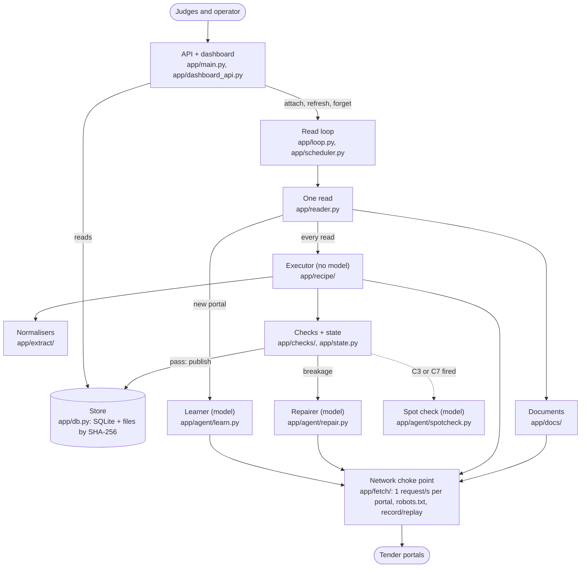

# Watchtower (Patterno track, MAIN AI Hackathon 2026)

Watchtower is an agent that attaches to a European public procurement portal it has never seen. It learns how to read the portal once, with a model. After that it reads the portal on a schedule with **no model call**, notices when the portal stops delivering correctly, and repairs itself. One Docker container serves the JSON API and the operator dashboard on port 8080.

**Hand-in deadline: Saturday 21 November 2026, 10:30.** Aim to submit by 09:30.

> This README is the team's guide and status tracker. Before hand-in, replace it with the required one-page README: how the system works, the environment variables, and what one portal costs in model usage (G4).

Contents:

1. [Quick start](#1-quick-start)
2. [Environment variables](#2-environment-variables)
3. [How it works](#3-how-it-works)
4. [Status checklist](#4-status-checklist)
5. [Repository structure](#5-repository-structure)
6. [What each file does](#6-what-each-file-does)
7. [Known gaps](#7-known-gaps)
8. [Rules for contributors](#8-rules-for-contributors)

---

## 1. Quick start

### Requirements

- Python 3.12 (3.11 or newer works). `.python-version` says `3.12`.
- pip 25.1 or newer, for `--group dev`.
- Docker, to build the image.
- Bun or npm, only to rebuild the dashboard.

### Install

```sh
python3.12 -m venv .venv
source .venv/bin/activate
pip install --upgrade pip
pip install -e . --group dev
```

Every dependency is declared in `pyproject.toml`. Runtime: fastapi, uvicorn, httpx, pydantic, lxml, cssselect, dateparser, tzdata, openai. Dev: pytest, httpx.

### Run the tests

```sh
pytest                      # every unit test under tests/ (no network, no model call)
pytest tests/contract       # the API contract test, in-process
CONTRACT_BASE_URL=http://localhost:8080 pytest tests/contract   # against a running container
```

Tests never reach a live portal and never call the OpenAI API. Model calls are mocked, and portals are the in-process mock portal.

### See the product on your machine (recommended first step)

```sh
python -m mock_portal.demo            # options: --port 8791 --host 127.0.0.1 --requests-per-second 25
```

Open http://127.0.0.1:8791/ and add the mock portal from the page, or from a second terminal:

```sh
curl -X POST http://127.0.0.1:8791/portals -H 'content-type: application/json' \
     -d '{"url": "https://mock.example"}'
```

The demo runs the real app, but its network layer only reaches two mock portals inside the same process. No request leaves your machine, whatever address you add. `https://mock.example` is read with the mock portal's hand-written recipe; any other address ends `failed`.

To show a break and a block:

| Route | What it does |
| --- | --- |
| `POST /demo/layout` | `https://mock.example` changes its layout. This is a breakage, repaired by the model (needs `OPENAI_API_KEY`). |
| `POST /demo/login-wall` | `https://login.mock.example` puts every page behind a login. This is a block, so the portal goes `failed`. |
| `POST /demo/reset` | Both mock portals work again. |
| `GET /demo/runs/{portal_id}` | The portal's runs, with model calls, cost and recipe version. |

The app notices on its next scheduled read (`READ_INTERVAL_SECONDS`), or at once on `POST /portals/{id}/refresh`.

### Run the app without the demo wrapper

```sh
uvicorn app.main:app --host 0.0.0.0 --port 8080
```

- Without `DATA_DIR`, records live in memory and nothing reads a portal (`app/memory_store.py`).
- With `DATA_DIR=./data`, records go to SQLite and the read loop runs.
- `FETCH_MODE` defaults to `replay` outside Docker, so nothing goes live by accident.

### Build and run the container

```sh
docker build -t watchtower .          # linux/amd64; base image mcr.microsoft.com/playwright/python:v1.65.2-noble
docker run -p 8080:8080 -e OPENAI_API_KEY=... -v "$PWD/data:/data" watchtower
```

The Dockerfile sets `DATA_DIR=/data` and **`FETCH_MODE=live`**, so the container reads real portals. Agents and tests must never run it against a live portal (see `CLAUDE.md`). Only a person decides to do that. `docs/handoff/docker-verify.sh` is a script that checks a built container.

### Rebuild the dashboard

The page at `GET /` is a static React build that is committed to `app/dashboard/static/`. Its source is in `dashboard/`.

```sh
cd dashboard
bun install            # or npm i
bun run build          # writes dashboard/dist/
bun run test           # vitest
```

Copy `dashboard/dist/` into `app/dashboard/static/` to ship it. Open `/?demo` to see the bundled demo data without a server.

### Use the API

| Call | Answer |
| --- | --- |
| `POST /portals` `{"url"}` | 201 `{"id"}` at once; the attach runs in the background. The same URL gives the same id. |
| `GET /portals`, `GET /portals/{id}` | `id`, `url`, `state`, `reason`, `tenderCount`, `lastSuccessAt` (plus `cause` and our extra fields) |
| `DELETE /portals/{id}` | 204; the portal stops being read within a minute |
| `POST /portals/{id}/refresh` | 202 `{"runId"}`; returns the running read's id if one is running |
| `GET /portals/{id}/tenders[?changedSince=]` | A bare JSON array of tenders |
| `GET /portals/{id}/runs` | A bare JSON array of runs (`read` or `repair`) |
| `GET /files/{id}` | The bytes of one document |
| `GET /` | The dashboard |
| `GET /api/dashboard`, `GET /api/portals/{id}/timeline`, `POST /api/settings` | Our own routes for the dashboard (`docs/DASHBOARD_API.md`) |

States: `integrating` (being attached), `serving` (delivering correctly), `healing` (broken, repair or retry running, last good tenders still served), `failed` (a person is needed).

---

## 2. Environment variables

| Variable | Default | What it does |
| --- | --- | --- |
| `OPENAI_API_KEY` | not set | Turns on the learner, the repairer and the spot check. Without it, only the mock portal can be attached. Never commit or log it. |
| `MODEL_LEARN`, `MODEL_REPAIR`, `MODEL_CHECK` | `gpt-6.2-sol`, `gpt-6.2-sol`, `gpt-6-luna` | The model for each job (`app/config.py`) |
| `EUR_PER_USD` | `0.90` (placeholder) | Rate for showing costs in euros. **Set it to the day's ECB rate at hand-in.** A value that is not a number stops the app at start. |
| `DATA_DIR` | not set (`/data` in Docker) | Where SQLite and the files live. Not set means in memory, with no read loop. |
| `FETCH_MODE` | `replay` (`live` in Docker) | `live`, `record` or `replay` |
| `FETCH_RECORDINGS_DIR` | `tests/fixtures/recordings` | Where recordings are written and read |
| `FETCH_USER_AGENT` | `Watchtower/0.1 (public tender monitoring)` | The client name sent to portals |
| `IGNORE_ROBOTS_TXT` | off | Testing only: ignore robots.txt. The dashboard can switch it too. |
| `READ_INTERVAL_SECONDS` | `120` | Shortest gap between two reads (the maximum is `READ_INTERVAL_MAX_SECONDS`, 1800) |
| `ATTACH_TIME_LIMIT_SECONDS` | `1200` | Attach time limit (20 minutes); can also be set from the dashboard |
| `MOCK_PORTAL` | `1` | Mount the mock portal at `/mock`. Set `0` to turn it off. |
| `MOCK_LEARNED_BY_MODEL` | off | Make the model learn the mock portal instead of using the hand-written recipe |
| `AGENT_<NAME>` | see `app/agent/settings.py` | Agent budgets: `AGENT_LEARN_MAX_TURNS` (40), `AGENT_REPAIR_MAX_TURNS` (20), `AGENT_LEARN_MAX_USD` (5.0), `AGENT_REPAIR_MAX_USD` (2.5), `AGENT_CONTEXT_TOKENS` (30000), and others |
| `RECIPE_<NAME>` | see `app/recipe/settings.py` | Executor limits: `RECIPE_MAX_PAGES` (500), `RECIPE_SINGLE_WITNESS_VOUCH_SHARE` (0.8), and others |
| `CHECKS_<NAME>` | see `app/checks/settings.py` | Check thresholds (Q10, Q14) |
| `LOG_LEVEL` | `info` | `debug` logs requests, checks, decisions, state changes, database writes, documents and agent calls (`app/logs.py`); per area with `LOG_LEVEL_FETCH` and the like. `LOG_FILE` writes to a file, `LOG_FORMAT=json` is the container's default. No key is written to a line. |
| `DOCS_<NAME>` | see `app/docs/settings.py` | Download and ZIP limits (250 MB per file, and others) |
| `EXTRACT_<NAME>` | see `app/extract/settings.py` | Normaliser settings |
| `FETCH_<NAME>` | see `app/fetch/settings.py` | Network numbers: timeouts, redirects, requests per second (1.0) |

Every number the design calls our own choice is a setting, not a constant in the logic.

---

## 3. How it works



1. **Attach.** `POST /portals` stores the portal and the loop starts a first read. The learner explores the portal with tools (`open_page`, `view_page`, `page_links`, `search_page`, `call_api`, `try_locator`, `propose_recipe`, `replace_node`, `check_recipe`). Its result is a **recipe**: a typed navigation graph in format `recipe/v1`. A recipe counts only once its dry run passes on the cached pages.
2. **Read.** On every scheduled read, the executor walks the recipe with no model call. It reads the list page by page, then detail pages and documents. The normalisers turn the raw text into contract values: dates with offsets, CPV codes, procedure type, country codes. When they are not sure, they return null.
3. **Notice.** The checks (Q10) judge each read: transport (T1, T2), outcome (O1, O2), content (C1 to C7), files (D1) and age (F1). A first failure is a suspect and gets a second look. `decide` in `app/state.py` turns the results into the state, the reason sentence and the `cause` (`outage`, `block` or `breakage`).
4. **Repair.** On a confirmed breakage, the repairer gets the old recipe, the failed checks and fresh pages, and changes as little as it can. The reader verifies the new recipe with a full trial read before it replaces the old one. The last good tenders stay served while the portal is `healing`.
5. **Failed portals** are checked again after 5 minutes, 15 minutes and 1 hour, then every 6 hours. A login or captcha wall is never bypassed; it ends in `failed` with that reason.

Measured cost so far, on the mock portal only: a learn costs $0.12 to $0.14 and a repair $0.08 to $0.10, on `gpt-6.2-sol`. No real portal has been measured yet. A regular read costs $0.

---

## 4. Status checklist

`[x]` done · `[ ]` open. Ticks were updated on 20 Nov 2026 by reading the code on `main` (commit `ed03b9e`). A tick means the code exists; it does not mean it was tried on real portals. Put your name after **Owner**.

### Who owns what

- **Baris:** Q5, Q7, Q8
- **David:** Q1, Q3, Q4, the network layer (`app/fetch/`), G2 the database
- **Danil:** Q2, Q9, Q11
- **Goktug:** Q6, Q10, Q12, Q13, Q14 (rules), G1 the API, the recipe, the executor, the read loop, the mock portal, and the agent (`app/agent/`, second Claude session)
- **Danil and Baris:** G3, the dashboard and frontend
- **Not assigned yet:** G4 to G8, G11

Who builds what and in what order: [docs/BUILD-PLAN.md](docs/BUILD-PLAN.md).

### [ ] Q1. Recipe model (Owner: David)
- [x] Research: `research/q01-recipe-model.md`
- [ ] Team agrees on the format
- [x] Recipe Pydantic model, format `recipe/v1` (`app/recipe/schema.py`)
- [x] Executor that runs a recipe with no model call (`app/recipe/run.py`): list, paging, detail pages, JSON API, multi-step
- [ ] Executor tests on **recorded real** pages (`tests/fixtures/` does not exist yet; today's tests use the mock portal)

### [ ] Q2. Field locators (Owner: Danil)
- [x] Research: `research/q02-locators.md`
- [x] Locator types: CSS, XPath, label, JSON path, fallbacks (`app/recipe/schema.py`, `app/recipe/locate.py`)
- [x] Two-witness rule: locators that agree give the value, a conflict gives null (`app/recipe/resolve.py`)
- [x] Value checks per field, C2 (`app/checks/values.py`): id shape, markup, deadline before publication
- [x] Normalisers (`app/extract/`): dates and times with offset, CPV, procedureType, contractNature, ids, countries

### [ ] Q3. Explore or map first (Owner: David)
- [x] Research: `research/q03-explore-or-map.md`
- [ ] Source prober as its own step. Today the learn prompt tells the model to look for JSON APIs, feeds and embedded state first (`app/agent/prompts/learn_system.md`), but no code probes on its own.
- [ ] Summary page detection: an entry URL that is not the tender list leads to the real list

### [ ] Q4. Agent tools (Owner: David)
- [x] Research: `research/q04-agent-tools.md`, `research/q04-page-views-measured.md`
- [x] Fetch interface and HTTP side (`app/fetch/`): 1 request start per second per portal, redirects hop by hop, T1 and T2, robots.txt
- [ ] Live browser side (Playwright). `browse` only replays recordings; live mode raises `NotImplementedError`.
- [x] `NetworkEntry` with `looks_like_tender_list` in the models and fetch layer; [ ] no live capture yet (needs the browser)
- [x] Compact page view for the model (`app/agent/views.py`)
- [x] Agent tools (`app/agent/tools.py`): open page, view page, links, search, call API, try locator, propose recipe, replace node, check recipe
- [x] Login and captcha detection (`app/fetch/answer.py`)

### [ ] Q5. Agent framework and conventions (Owner: Baris)
- [x] Research: `research/q05-agent-framework.md`, `research/q05-q07-q08-framework-schemas-benchmark.md`
- [x] Conventions: `CONVENTIONS.md`. Decision: our own loop on the Responses API, not the Agents SDK.
- [ ] Team agrees on the project layout in `CONVENTIONS.md`
- [x] `app/agent/runner.py`: budgets, context trimming, the one retry, token and cost bookkeeping, `AgentStep` logging
- [x] Learn agent (`app/agent/learn.py`), repair agent (`app/agent/repair.py`), spot check (`app/agent/spotcheck.py`), prompts in `app/agent/prompts/`
- [x] Wired into the app: `Agents.from_env` in `create_app`, fallback to the hand-written mock recipe when no key is set

### [x] Q6. Language (Owner: Goktug)
- [x] Research: `research/q06-language.md`. Python for everything.
- [x] Dockerfile at the root, linux/amd64, built in CI on every pull request
- [x] Default command serves the API and dashboard on port 8080

### [ ] Q7. Schemas (Owner: Baris)
- [x] Research: `research/q07-schemas.md`, `research/q05-q07-q08-framework-schemas-benchmark.md`
- [x] `app/models.py`, `app/schema.sql`, tests in `tests/test_models.py`
- [ ] Verify the eForms BT numbers marked (*) in `app/models.py`
- [x] Recipe `body` format: `RecipeBody` in `app/recipe/schema.py`
- [ ] Align check names with Q10
- [ ] The five requests in `docs/SHARED-INTERFACE-REQUESTS.md` (incident facts, row hash, portal's own "closed", `subject` on checks, ZIP skip reason). Each needs its own pull request, approved by a person.

### [ ] Q8. Benchmark (Owner: Baris)
- [x] Design: `docs/BENCHMARK.md`
- [x] Mock portal: server-rendered template with 13 switches, two layouts, a second portal for the login wall, mounted at `/mock`, and demo routes
- [ ] Mock portal: JSON and multi-step templates, the large variant, the 250 MB ZIP, the scenario runner
- [x] Record and replay in `app/fetch/` (`FETCH_MODE`)
- [x] Real test set: `bench/portals.toml` (49 portals in 7 countries plus Mercell), read by `bench/portals.py`
- [ ] Record the test set (a person, `FETCH_MODE=record`), Poland first; find the missing addresses
- [ ] Gold labels: open-id list per portal plus 5 checked tenders each
- [ ] Harness and scorer (`bench/run.py` does not exist yet)

### [ ] Q9. OpenAI models and cost (Owner: Danil)
- [x] Research: `research/q09-models-cost.md`
- [x] `app/config.py`: model per job and the price table (copied 20 Nov 2026)
- [x] Cost measured on the mock portal (learn $0.12 to $0.14, repair $0.08 to $0.10)
- [ ] Pick models from the benchmark (needs Q8)
- [ ] Cost per portal measured on real portals, for the hand-in README

### [ ] Q10. Failure rules (Owner: Goktug)
- [x] Research: `research/q10-failure-rules.md`
- [x] `outage` severity and `cause` on a portal (PR 18); since 20 Nov 2026 an outage is `failed` with cause `outage` from the first read that finds it (it was `healing` without a repair), and the last good tenders stay served
- [x] Checks (`app/checks/`): T1, T2, T4, O1, O2, C1 to C7, D1, F1 and the confirm step
- [x] State machine (`app/state.py`)
- [x] Checks and `decide` called from the read loop; last good tenders stay served while healing
- [x] No false alarm on portals with few or no tenders, in unit tests
- [ ] The same on the mock portal (scenario 13)

### [ ] Q11. Reuse across portals (Owner: Danil)
- [x] Research: `research/q11-reuse.md`
- [x] Fingerprint detector: `app/software.py` (`detect()`, `best()`); the reader stores the family on the portal and the recipe
- [ ] Reuse rule: try candidate recipes by host, path, brand or structure, trusted only after canary read, full first read and spot check

### [ ] Q12. Large portals (Owner: Goktug)
- [x] Research: `research/q12-large-portals.md`
- [x] Mentors asked: the harness waits 20 to 30 minutes, and documents may still be pending while `serving`
- [x] Incremental reads: the plan (`plan_incremental_read`) and its use in the loop
- [x] Documents module (`app/docs/`): streaming, SHA-256, 250 MB limit, content-addressed store, nested ZIPs
- [x] File test of `app/checks` used by documents (`app/docs/judge.py`)
- [x] Documents wired into the reader: downloads through `app/fetch/`, records in `app/db.py`
- [ ] A document fetched by POST (the executor reports it as a problem)

### [ ] Q13. Read schedule (Owner: Goktug)
- [x] Research: `research/q13-read-schedule.md`: every 2 minutes, or 10 times the list's read time, at most 30 minutes
- [ ] Team agrees on that rule
- [x] Rules as functions in `app/scheduler.py`
- [x] The loop that calls them (`app/loop.py`): one task per portal, refresh

### [ ] Q14. Retrying failed portals (Owner: Goktug)
- [x] Research: `research/q14-failed-retry.md`
- [ ] Team agrees on that rule
- [x] Rules as functions in `app/scheduler.py`
- [x] Recheck job in the loop

### [ ] G. Work outside any one question
- [x] G1. API (`app/main.py`): every endpoint of the contract, plus `/files/{file_id}`
- [x] Contract test (`tests/contract/`); CI runs it against the built container
- [x] G1 store wiring: `DATA_DIR` gives SQLite (`app/db.py`), otherwise in memory
- [x] G1 worker wiring: `DATA_DIR` gives the read loop (`app/loop.py`, `app/reader.py`)
- [x] G2. `app/db.py` on `app/schema.sql`, tests in `tests/test_db.py`; research in `research/q15-storage.md`
- [x] G3. Dashboard at `GET /`: portals, state, reason, what broke, what the system did, cost
  - [x] No demo data in place of a down API; demo only with `?demo`
  - [ ] The page does not know severity `outage` (sent as `fail`)
- [ ] G4. Hand-in README (one page: how it works, env vars, cost per portal)
  - [ ] Set `EUR_PER_USD` to that day's ECB reference rate
- [ ] G5. Video, at most 3 minutes, dashboard included (the mock break and repair makes a good demo)
- [ ] G6. Dedicated OpenAI key with a spending limit for the judges, revoked after judging
- [ ] G7. Team decision on the Patterno participant declaration
- [ ] G8. Submit the repository link
- [x] G9. Recipe schema before the agents fan out (`app/recipe/schema.py`, examples in `tests/recipe/examples.py`)
- [x] G10. `CLAUDE.md` rule: no agent sends requests to a live portal
- [ ] G11. Development OpenAI key with its own spending cap (the rule is in `CLAUDE.md`; the key itself is still to make)
- [ ] Before hand-in: delete `docs/HANDOFF.md` and `docs/handoff/`, as `docs/HANDOFF.md` asks
- [ ] Team decision: `POST /api/settings` can switch robots.txt off and has no authentication

---

## 5. Repository structure

```
.
├── README.md                 this file
├── DESIGN.md                 the spec (draft 3)
├── CLAUDE.md                 rules for the AI agents that build the system
├── CONVENTIONS.md            project layout and the 13 coding rules
├── Dockerfile                image: Playwright base, Python 3.12, uvicorn on :8080
├── pyproject.toml            package "watchtower", dependencies, pytest settings
├── .github/workflows/ci.yml  CI: unit tests, docker build, contract test against the container
├── .python-version, .gitignore, .dockerignore
├── app/                      the Python application (everything that ships)
│   ├── main.py               FastAPI app: contract API, dashboard, files
│   ├── dashboard_api.py      the dashboard's /api routes
│   ├── interfaces.py         Store and Worker protocols
│   ├── models.py, schema.sql shared records and SQLite tables (shared interface)
│   ├── db.py                 SQLite store
│   ├── memory_store.py       in-memory store and idle worker
│   ├── loop.py               read loop (asyncio, one task per portal)
│   ├── reader.py             one read of one portal
│   ├── scheduler.py          scheduling rules as pure functions
│   ├── state.py              checks → state, reason, cause
│   ├── config.py             models and prices
│   ├── software.py           portal software fingerprint
│   ├── agent/                learner, repairer, spot check, runner, tools, prompts
│   ├── checks/               the Q10 checks
│   ├── docs/                 document download, hashing, ZIPs, file store
│   ├── extract/              normalisers (dates, CPV, enums, countries)
│   ├── fetch/                the network choke point
│   ├── recipe/               recipe schema and executor
│   └── dashboard/static/     built dashboard (from dashboard/)
├── dashboard/                React + Vite + Tailwind source of the dashboard
├── mock_portal/              fake tender portal we break on purpose, plus the demo server
├── bench/                    real test portals list (never fetched by agents)
├── tests/                    pytest suites, one folder per module
├── docs/                     build plan, handoff, dashboard API, benchmark, interface requests
├── research/                 Q1 to Q15 research answers, audit, tools, measured sources
└── hackathon-pdfs/           track description and participant declaration
```

---

## 6. Known gaps

What is missing or limited on `main` today:

- **No live browser.** `browse` only replays recordings, so a portal that needs JavaScript to show its list cannot be read live.
- **No recordings.** `tests/fixtures/` does not exist yet, and no real portal has been recorded, learned or measured.
- **Not supported by the executor** (each is reported as a problem): browser steps, `load_more` paging, `platform_ref` nodes, documents fetched by POST.
- **Incident facts live in memory.** Outage timers, repair caps and failed-portal check times reset on a restart (`docs/SHARED-INTERFACE-REQUESTS.md`, item 1).
- **Checks not fully run:** C3 and C5 suspects are confirmed without a second fetch, and the canary (C6) is not run.
- **Regular expressions** in a recipe are capped by input length, not by a timeout.
- **Benchmark harness** (`bench/run.py`) and gold labels do not exist.
- **Reuse across portals** stops at detection; no candidate recipe is tried yet.
- **Docs drift.** `DESIGN.md` says the dashboard is server-rendered with no build step, but it is a React build. `DESIGN.md` also names the Agents SDK, while `CONVENTIONS.md` and the code use our own loop. The docstring of `app/scheduler.py` says the loop is "added later", but it is in `app/loop.py`.

---

## 7. Rules for contributors

Read `CLAUDE.md` and `CONVENTIONS.md` before you change anything. In short:

- Never commit to `main`. Use a branch named `<name>-<work>`, open a pull request, and merge it after CI passes.
- `app/models.py`, `app/schema.sql` and `app/recipe/schema.py` change only in their own pull request, approved by a person.
- Never send a request to a live portal from an agent session, a test or a script. Use the mock portal or recordings.
- Never call the OpenAI API from tests. Live model calls only when a person asks, on the development key.
- Every request goes through `app/fetch/`. Every model call goes through `app/agent/runner.py`.
- A pull request is done when the unit tests, the contract test and `docker build .` pass. Say which ones you ran.
