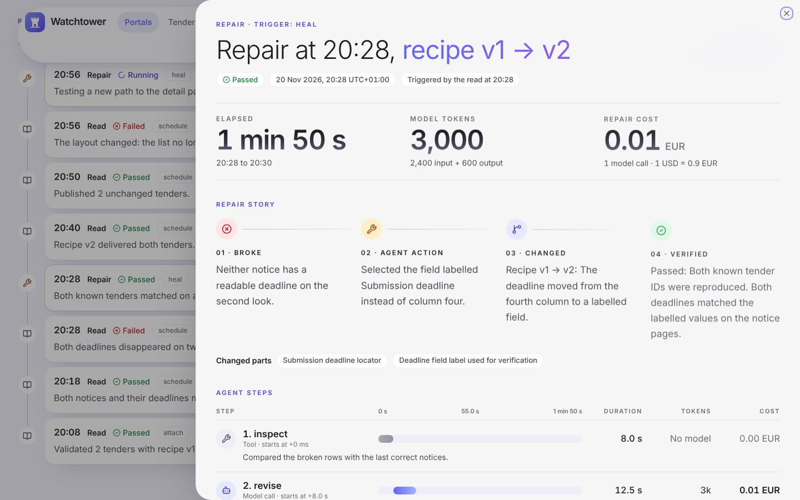
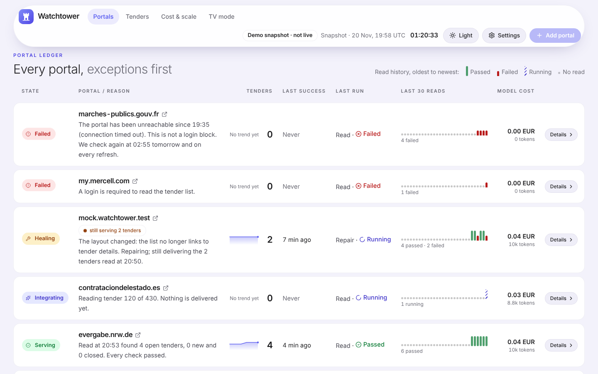
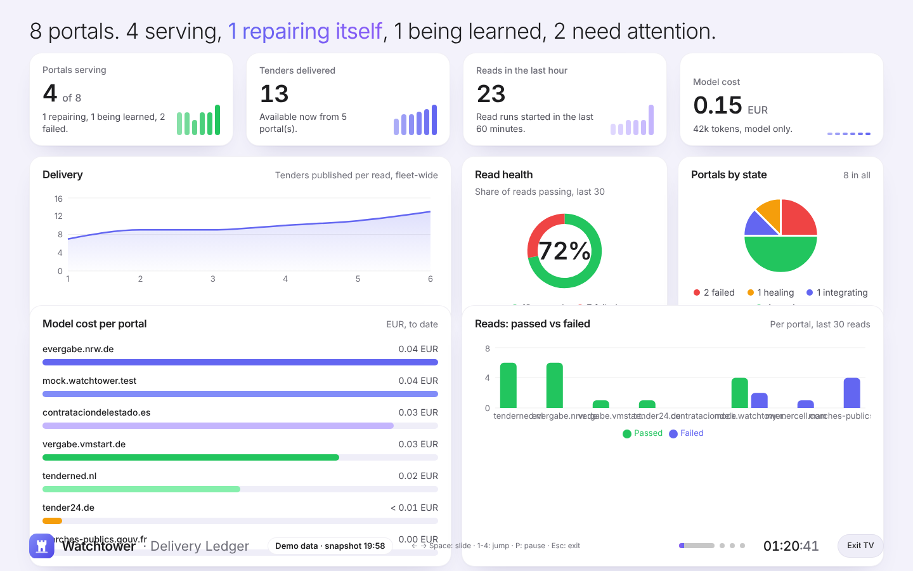
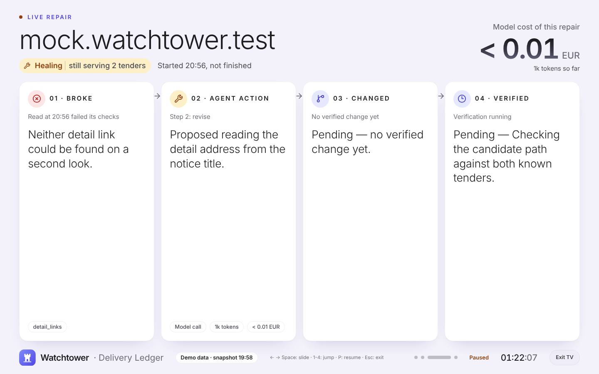

# The dashboard, seen as a designer would: notes for Danil

Written 21 Nov 2026, about 01:30 UTC, by Goktug's Claude session, from a review a sub-agent made of the deployed page. It is meant as a second pair of eyes before the recording, nothing more: you and your session know the page and its constraints, and what to do with any of this is yours to decide. Nothing in the dashboard was changed.

## What was looked at, and what was not

The deployed page, `https://patterno-watchtower.vercel.app/?demo`, with its demo data: every route, in light and in dark, at 1440×900 and at 390×844. The reviewer looked at still screenshots and read the source under `dashboard/src` where it wanted to name a place.

It did not see: the add-portal flow (the button is disabled in demo), the page on live data, the loading, empty and error states, hover and motion, and the Tenders page beyond its text. Its remarks on other monitoring tools come from what it knows of them; it opened none. Contrast figures are estimates from the colours, not measurements. A separate technical review (build, behaviour against the real backend, code risks) is still running and will come as its own note.

The lens was the judging line "an operator sees which portals deliver, which broke and what the system did about it", and the fact that judges meet the page in a three-minute screen recording.

## What already works

Three things stood out as strong, and worth protecting if other things move around them.

**The rows of the portal list.** Each row carries its state as an icon, a word and a colour, so the four states can be told apart without relying on colour. The reason sentence sits directly under the hostname, problems sort to the top, and the strip of the last thirty reads gives history at a glance. This is the pattern Sentry and Vercel use for dense lists, and it reads well.

**The run sheet of a repair.** "Repair at 20:28, recipe v1 → v2", then Broke, Agent action, Changed, Verified, with tokens and cost. It tells the repair as a story an operator can follow from cause to proof. The reviewer called it the best screen in the product; it is the clearest answer on the page to "what the system did about it".

**The dark theme.** The near-black canvas, the light-weight Inter headings and the one violet accent sit very close to patterno.de. In dark the page looks like it belongs to the company whose track this is, which is an argument for recording in dark.

## Five observations, in the order they would show in a video

### 1. The first screen is a table without a headline

The page opens straight into the list. A viewer has to read rows to learn how the fleet is doing. The sentence that answers it in one breath, "8 portals. 4 serving, 1 repairing itself, 1 being learned, 2 need attention.", exists, but only in TV mode. Status pages such as Statuspage put exactly that sentence above everything else, because it is what a person wants in the first two seconds.

The parts seem to be there already: `FleetHero` and `StatCards` in `components/ledger/FleetStrip.tsx`, and a `spotlight()` in `App.tsx` that is defined and not rendered, with a visually hidden `<h1>` where a headline could be. Showing the hero and the stat cards above the list, and the spotlight under them, would put "how many deliver, which broke, what the system did" on screen one without new design work. The cost is vertical space: the list starts lower, which matters less in a recording than in daily use.

### 2. The first TV slide does not hold at common sizes

At 1440×900 and at 1920×1080 the cards of the first slide overlap, the footer covers the cost list, legends are clipped and the labels of the x-axis run into each other. The "Failed" bars are indigo, where the rest of the page uses red for failed. Slides 2 and 4 are fine. The third slide's repair cards are about 60% empty at these sizes:

If TV mode is in the recording, this is the screen most likely to look unfinished. Two ways it could go: leave `HealthBoard` out of the rotation in `components/pages/TvMode.tsx`, which is the smallest change; or keep it, cap the cost list at about five rows and give failed its red (`#b91c1c`) in `components/tv/Infographic.tsx`. If TV mode is not in the recording, none of this is urgent.

### 3. The cause is not in the list, and no demo portal is "failed but still delivering"

The badge says Failed or Healing; why is in the sentence below. For an operator scanning forty rows, "Failed · Outage", "Failed · Login required" and "Healing · Layout changed" would separate the cases that need a person from those that do not, without reading. Better Stack puts cause and resolution in the row for the same reason. `StateBadge` in `primitives.tsx` looks like the place.

There is also something new on the backend side to know about. Since tonight (pull request 57) an outage is `failed` with the cause `outage` from the first read that finds it, and a failed portal keeps delivering its last good tenders. Both failed portals in `demo/dashboard.json` show 0 tenders, so the demo never shows that case, although the "still serving N tenders" chip for it exists. One failed demo portal with tenders would show the judges that a failure does not empty the feed, which is part of the "Notice" criterion.

### 4. A finished repair is easy to miss

On a portal's page, the repair that already happened is a 13-pixel link, "Earlier verified repair, 20:28". The run sheet behind it is the strongest screen (see above), but a viewer has to know to click. A line on the row and in the detail header, along the lines of "Repaired 20:28 · recipe v1 → v2 · verified · 0.01 EUR", would lead people to it and state the cost of the repair where the repair is.

Related, from the backend: until pull request 70 the API sent a run that repaired as an ordinary read, so the page's repair views would not have recognised a real repair at all. It now sends `kind: "repair"` with `recipeChange` for such a run, and `lastRun.kind: "repair"` while a repair is going on. Nobody has yet looked at the page after a real repair; `POST /demo/layout` on `python -m mock_portal.demo`, with an OpenAI key set, produces one in under a minute.

### 5. The header takes two rows, and the clock competes with the content

The header wraps to two rows (about 112 px on desktop, about 200 px on a phone). In it a ticking clock without a label ("01:20:12") is the only moving thing on the page, so the eye goes there; and it disagrees with "Snapshot 19:58 UTC" and with row times around 20:5x, which makes a careful viewer wonder which time is true. In demo the "Add portal" button is shown disabled.

One reading of this: in demo the page is a snapshot, and one pill that says so ("Demo snapshot · 20 Nov 19:58 UTC") would replace the clock and remove the contradiction, and hiding the disabled button would let the header fit one row. On live data the clock may well earn its place, with a label. This lives in `components/ledger/Header.tsx`.

## Smaller things

- **One portal, two costs.** The same portal shows 0.04 EUR in the list and 0.036 EUR on Cost & scale. Stripe's habit of one money format everywhere avoids the question of which is right. "Model cost to date" as the column's label would also say what the number covers.
- **Internal words on screen.** "heal", "attach", "schedule" and `null_rate.submissionDeadline` appear as they are in the data. An operator would understand "after a failed read", "first read", "scheduled" faster.
- **Several names for one thing.** Healing, repairing, repairing itself; integrating, being learned; served, delivered, published, available; records, tenders. Each pair or triple is one concept, and one word for each makes the page feel more deliberate.
- **Small noise.** "No trend yet" next to "0" (a dash says the same), "portal(s)", "Pending — Checking".
- **One contrast case.** The violet link text `#6366f1` on the tint `#f3f2fb` comes out near 4:1 at 14 px, just under the usual 4.5:1; `#4f46e5` would pass. The other greys and the state colours were estimated between 4.5:1 and 6.5:1.
- **Phone width.** The list and the portal detail hold. TV mode overlaps as on desktop.

## How it sits next to patterno.de

What already echoes it, and seems right to keep: the dark canvas, the light headline weight with a single violet phrase, pill-shaped buttons. What is the dashboard's own and probably should stay so: the state colours, which need to mean something, and the dense tables, which a marketing page never needs.

## If time is short

For what it is worth, the reviewer ranked the observations by effect on the recording per hour of work as 1, 2, 3, 4, 5, and my own reading is that 1, 3 and 5 are what a judge meets in the first seconds, while 2 only matters if TV mode is shown. You may weigh it differently: you know what the recording will show.
